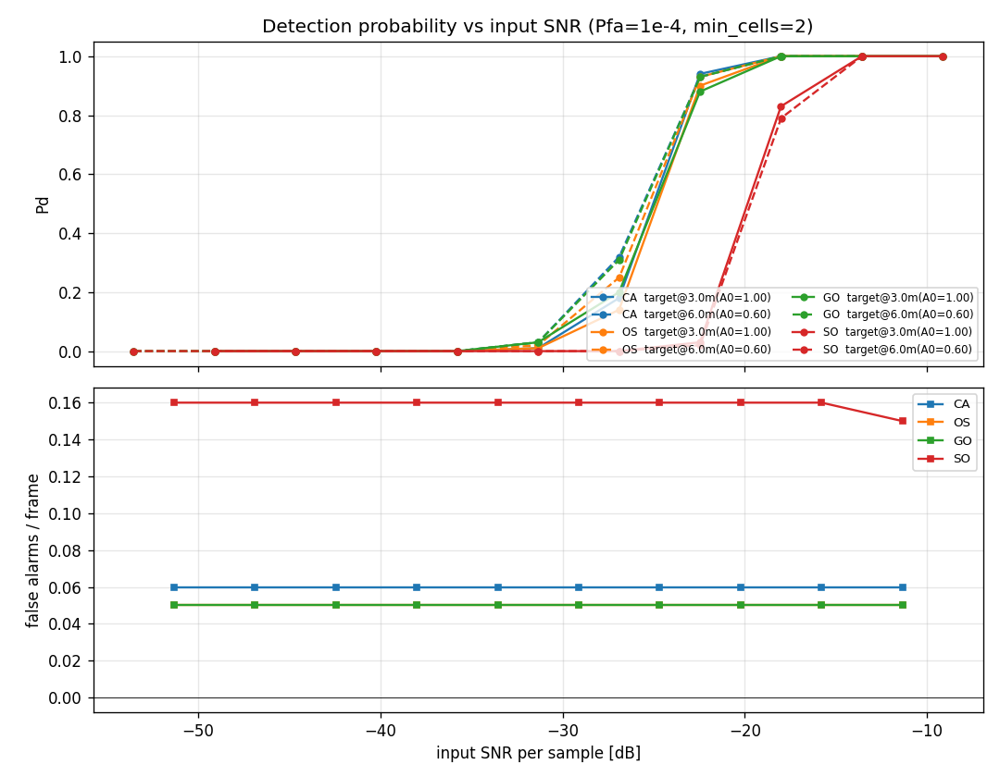
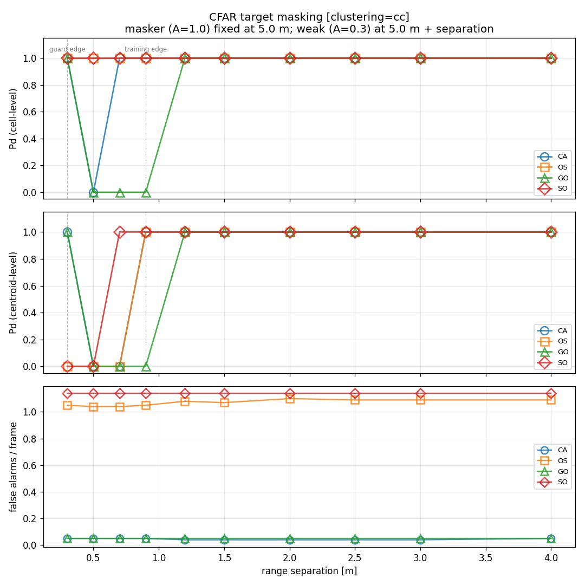
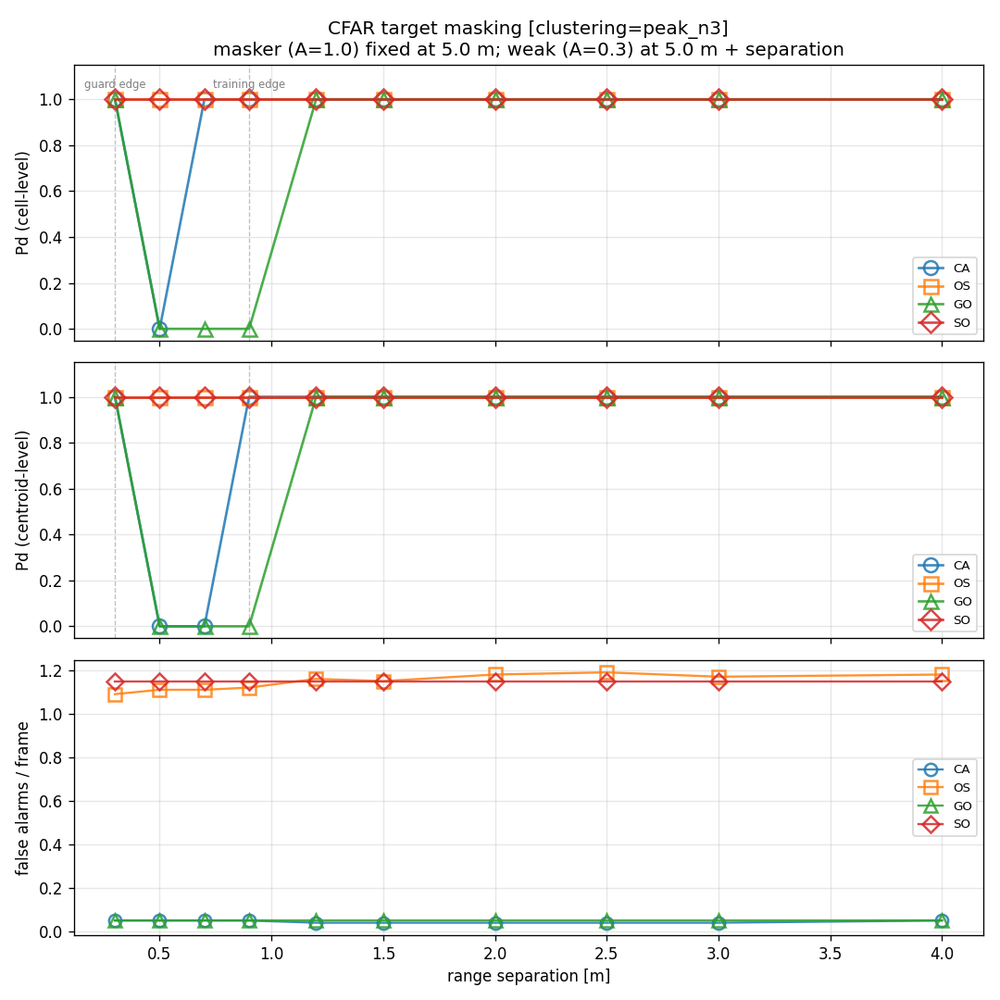
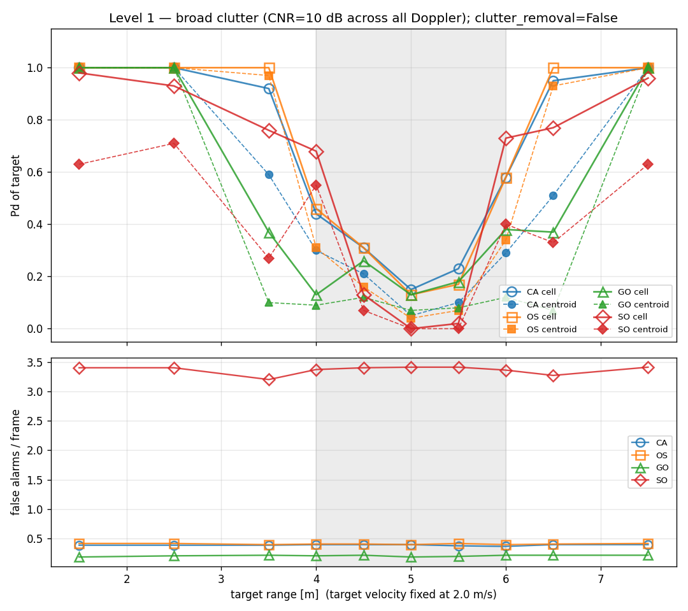
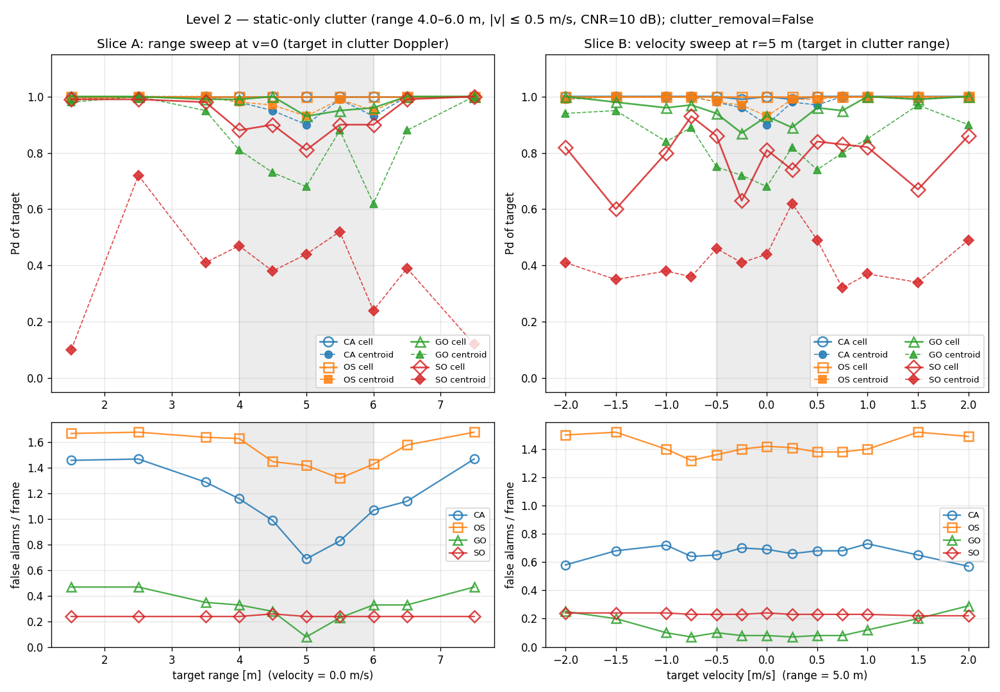
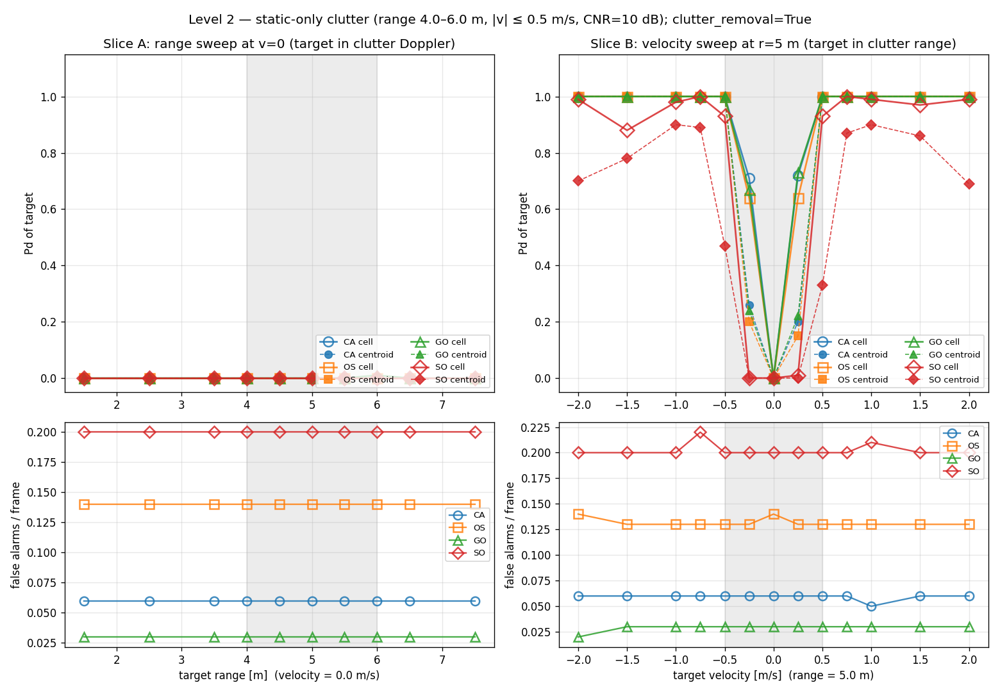

# Detection Performance Test — CFAR Methods and Clustering

**Date:** 2026-06-08
**Branch:** `feat/add-detection-test-report`
**Pipeline under test:** `range_doppler` (Hann window, DC removal) → `cfar_2d`
(empirically Pfa-calibrated) → `cluster` → discrete detections.

---

## 1. Introduction

The **detector** turns each range-Doppler map into a discrete list of target
detections: it decides which range-Doppler cells contain a target, then groups the
detected cells into individual detections. Those per-frame detections are the input
to the tracker (the subject of the companion *Tracker Stress Test* report), so the
detector sits one stage upstream in the same pipeline. It works in two stages:

1. **CFAR** (Constant False-Alarm Rate) — a per-cell threshold test. For each
   cell it estimates the local noise from surrounding *training* cells and
   declares a detection if the cell exceeds `α × noise_estimate`, where `α` is
   calibrated to a design false-alarm rate (Pfa). The methods differ only in
   *how* they turn the training cells into one noise estimate.
2. **Clustering** — adjacent detected cells belonging to one target are collapsed
   into a single detection (a range-Doppler centroid).

This report characterizes the detector along the two axes of choice the
implementation exposes — **four CFAR methods** and **three clustering methods** —
under three controlled experiments:

- **Four CFAR methods** — they differ in the *noise-estimate operator* applied to
  the training cells:
  1. **CA** — Cell-Averaging: the mean of all training cells. The classic CFAR;
     optimal in homogeneous noise, but a single strong neighbour inflates the
     estimate.
  2. **OS** — Ordered-Statistic: the *k*-th ranked training cell (here the 75th
     percentile). Robust to a minority of contaminated training cells.
  3. **GO** — Greatest-Of: the **larger** of the leading/lagging (here, the four
     quadrant) training means. Suppresses false alarms at clutter edges, but
     masks a weak target next to a strong one.
  4. **SO** — Smallest-Of: the **smaller** of the training means. Resists masking
     (it ignores the contaminated side), at the cost of more false alarms.

- **Three clustering methods** — they differ in how detected cells become
  discrete detections:
  1. **`cc`** — Connected-Components: label connected blobs of detected
     cells (8-connectivity), emit one detection per blob at its centroid.
  2. **`dbscan`** — density-based: group cells by density(groups cells within eps that meet min_samples),
     discard sparse cells as noise.
  3. **`peak`** — Peak-Picking: keep only cells that are a local maximum within a
     neighbourhood; isolates distinct peaks rather than merging blobs.

The three experiments each isolate a different detector stress:

| Experiment | What it stresses |
|---|---|
| **Amplitude sweep** | raw sensitivity — Pd vs SNR in homogeneous noise |
| **Target masking** | resolving a weak target beside a strong one (CFAR self-masking + clustering merge) |
| **Clutter edge** | detecting a target inside / beside a clutter region (CFAR clutter rejection) |

The first experiment measures the baseline each method achieves when nothing is adverse;
the second and the third experiments are where the four methods separate, and where the CA/OS/GO/SO trade-offs
above become visible numbers. Sections 3–5 take them in turn; Section 6 distils
*which method to use when*, and Section 7 records limitations.

---

## 2. Methodology

### 2.1 Fixed pipeline lens

Every experiment uses one fixed signal-processing front-end so that the CFAR (or
clustering) choice is the only variable:

| Stage | Choice | Rationale |
|---|---|---|
| Range-Doppler | Hann window, DC removal | standard; suppresses spectral leakage and the DC ridge |
| CFAR | `pfa = 1e-4`, guard `(2,4)`, training `(4,8)` | fixed design Pfa and reference geometry across all methods |
| Clustering | `min_cells = 2` | one detection per blob |

The four CFAR methods share the same guard/training geometry and design Pfa — only
the noise-estimate operator changes — so any difference in Pd or false-alarm rate
is attributable to the operator, not to a tuning advantage. The three clustering
methods all apply the `min_cells = 2` filter — a detection is dropped if its
cluster of cells numbers fewer than two. This includes `peak`: a peak detection is
sized by the blob it sits in (not counted as a single cell), so an isolated
one-cell peak is rejected just as under `cc`.

### 2.2 Empirical α calibration

Every method's threshold is `α × noise_estimate`, and `α` is what makes the design
Pfa meaningful. Rather than use the textbook closed-form `α` (which assumes
independent, exponentially-distributed cells), this implementation **calibrates α
empirically** by:

- **drawing** pure-noise range-Doppler power maps **through the same processing
  chain** the live pipeline uses (the same Hann windowing, DC removal, and optional
  clutter removal), so adjacent cells carry the correct window-induced correlation
  and the same "dead" cells (range bin 0, the clutter-removal Doppler bin);
- **running** each method's noise-estimate operator on those maps and taking the
  `(1 − Pfa)` quantile of the cut/noise ratios as `α`.

This matters because the Hann window's power autocorrelation spans a few bins, so
the cells are **not** i.i.d. exponential; the analytical formulas are biased, and
SO in particular miscalibrates near the dead cells. Calibrating against the real
processing chain removes that bias. (`processing/cfar.py`, `_alpha_empirical` /
`_windowed_noise_rd_maps`; 300 calibration frames per configuration.)

### 2.3 Metrics

For each (method, sweep-position) we run N frames and report:

- **Cell-level Pd** — fraction of frames in which the target's true range-Doppler
  cell is above threshold (did the *detector* find it).
- **Centroid-level Pd** — fraction of frames in which *clustering* produced a
  detection whose centroid matches the target within **±1 range bin and ±1
  Doppler bin** (did a discrete detection survive clustering).
- **False alarms / frame** — detected centroids that match no target.

Separating cell-level from centroid-level Pd is deliberate: it tells a CFAR
*masking* failure (cell never crosses threshold) apart from a *clustering* merge
(cell detected, but absorbed into a neighbour's blob). The two have different
fixes, and §4 shows both occurring.

### 2.4 Two independent RNG streams (seed hygiene)

The detection chain draws random numbers in two separate places, and keeping their
seeds independent is what makes the measured Pfa/Pd an honest *out-of-sample*
number:

| Stream | Seeded by | Role |
|---|---|---|
| **Signal generator** | `RadarConfig.seed` (`99999`) | the noisy frame the detector works on |
| **CFAR calibration** | `_alpha_empirical(seed=0)` | the pure-noise pool used to set `α` |

If the generator drew its noise from the **same** seed as the calibration, the
threshold would be tuned in-sample to the very noise it is then applied to, and any
"empirical Pfa" measured downstream would be self-consistent with the calibration
data rather than a true measurement. The codebase guards against this by defaulting
`RadarConfig.seed` to `99999`, decoupled from CFAR's `0` (the unit tests use
`12345` to make the requirement explicit). All plots in this report use the
post-fix, decoupled streams.

---

## 3. Amplitude sweep — sensitivity in homogeneous noise

This experiment measures the baseline each method achieves when nothing is
adverse: a clean two-target scene in thermal noise, with the target amplitude
swept to trace out the Pd-vs-SNR curve.

**Scenario** (`scenario_two_targets.json`): two slow targets, one at 3 m
(+0.1 m/s, base amplitude 1.0) and one at 6 m (−0.1 m/s, base amplitude 0.6), in
homogeneous noise
(`noise_power = 1e-4`) with a small DC-leakage ridge (`leakage_amplitude = 0.02`).
The amplitude is scaled across **10 log-spaced points** (3.5e-5 → 3.5e-3), and for
each (method, scale) we run 100 frames. The x-axis is the **input SNR per sample**
`20·log₁₀(amplitude/√noise_power)`, ≈ −49 → −9 dB. The reported **Pd is
centroid-level** (post-clustering, `min_cells = 2`): with the two targets far
apart there is no clustering merge, so cell-level and centroid-level coincide and
we plot the single end-to-end number — unlike §4, where they diverge.

CMD: `python -m evaluation.sweep_amplitude --scenario scenarios/scenario_two_targets.json --frames 100`

The plot result shows, **CA, OS and GO are indistinguishable.** Their Pd curves overlap: detection climbs
from ~0 to ~1 over roughly **−35 to −18 dB** per-sample SNR (the strong 3 m target
leads the weaker 6 m target by a few dB, as Pd-vs-SNR predicts), and all three sit
at a false-alarm rate of **~0.05–0.06 per frame** — the level the empirical α
calibration targets for Pfa = 1e-4 after integration. In clean homogeneous noise
the noise-estimate operator simply does not matter: averaging, ranking, and
greatest-of all see the same well-behaved training cells.

**SO pays a real penalty for no benefit here.** The smallest-of curve is shifted
right — its 50 % point sits about **5 dB higher for the strong target and ~9 dB
higher for the weak one** (e.g. at scale 1.26e-3 the strong-target Pd is 0.83 for
SO vs 1.0 for the others; the weak target reaches Pd 1.0 only at the last grid
point, one step behind) — **and** it runs **~3× the false alarms** (0.16 vs
0.05 per frame). Both follow from "smallest-of": taking the minimum training-quadrant
mean biases the noise estimate low, so the calibrated α must be larger to hit the
design Pfa (costing sensitivity), while at the residual DC-leakage edge the
smallest-of estimate still under-reads and leaks extra false alarms. SO's
masking-resistance — its reason to exist — buys nothing when there is nothing to
mask.

In homogeneous noise, **CA is the natural default**: simplest, and
matched by OS and GO. SO is strictly worse here. The methods only separate in
SO's and OS's favour once the training environment stops being homogeneous — a
strong neighbour contaminating the training cells (§4) or a clutter edge (§5) —
which is exactly what the next two experiments introduce.

---

## 4. Target masking — a weak target beside a strong one

This experiment introduces the first **non-homogeneous training environment**: a
strong masker whose energy contaminates the weak target's training cells, and a
weak target walking toward it. It asks *how close a weak target can sit to a strong one
before the detector loses it* — and it separates two distinct ways the detector
can fail.

**Setup** (`scenario_two_targets.json` radar config; targets overridden): a
**masker** (amplitude 1.0) fixed at 5.0 m, and a **weak target** (amplitude 0.3)
at 5.0 m + *separation*, both at v = 0 — a range-only sweep. The separation is
walked over `[0.3, 0.5, 0.7, 0.9, 1.2, 1.5, 2.0, 2.5, 3.0, 4.0]` m, 100 frames per
(method, separation). For the **weak** target, both **cell-level** Pd
(did its cell cross threshold) and **centroid-level** Pd (did clustering emit a
matching detection) are reported, plus false alarms/frame. The masker's own Pd stays ~1
throughout (a sanity check). Clustering uses `cc` method.

CMD: `python -m evaluation.sweep_masking --frames 100 --clustering cc`

The top two panels separate the two failure modes: CFAR theory speaks to the cell-level Pd; the centroid-level adds the clustering question on top. The two vertical dashed lines mark the weak
target's **guard edge** and **training edge** (the masker is inside the weak
target's training window between them).

**Cell level — CFAR self-masking (top panel).** This is where the four methods
genuinely differ:
- **GO masks** the weak target exactly while the masker sits in its training
  window: cell Pd drops to **0 at 0.5–0.9 m**, recovering only at ≥1.2 m once the
  masker clears the training ring. Greatest-of locks onto the masker-contaminated
  quadrant and raises the threshold above the weak target — the textbook GO
  weakness.
- **CA** shows a milder, single-point version (cell Pd 0 at 0.5 m only) — the
  masker inflates the *averaged* estimate just enough at that one geometry.
- **OS and SO never self-mask** — cell Pd = 1.0 at *every* separation. Ranking
  (OS) and smallest-of (SO) both ignore the one contaminated side, so the weak
  cell always crosses.

**Centroid level — clustering merge (middle panel).** Even when the cell *is*
detected, `cc` merges the weak target into the masker's blob at small gaps, so no
separate centroid survives: OS's centroid Pd is **0 at 0.3–0.7 m** and SO's at
**0.3–0.5 m**, despite cell Pd = 1.0 there. With `cc`, the practical
two-target resolution floor is ~0.7–0.9 m regardless of CFAR method.

**The false-alarm cost (bottom panel).** OS and SO buy their masking-immunity
dearly: **~1.05 (OS) and ~1.15 (SO) false alarms per frame**, versus **~0.05 for
CA and GO** — roughly **20×**. Near a strong target their permissive noise
estimates (a low rank, the smallest quadrant) read the masker's skirt as noise and
spawn detections around it.

Re-running the sweep with
`peak` clustering, it nicely **recovers OS and SO down to 0.3 m** —
peak-picking keeps both local maxima instead of fusing the blob, so their
centroid Pd becomes 1.0 at *every* separation. But `peak` leaves **GO unchanged**
(its cell never crosses — a CFAR failure no clustering can repair) and does not
rescue **CA** at 0.7 m either, where the weak target isn't a distinct local max — both consistent with "needs an above-threshold local maximum to pick." So the lever depends on the failure: a *merge* is
fixed by the clustering stage (`peak`), a *mask* only by the CFAR stage (avoid GO).

CMD: `python -m evaluation.sweep_masking --frames 100 --clustering peak`

The middle panel makes the split visible: OS and SO snap to centroid Pd = 1.0 at
every separation (the `cc` merge is gone), while CA and GO keep the same dips as
under `cc` — their failures are upstream of clustering. The false-alarm panel is
essentially unchanged from `cc` (OS/SO ~1.1, CA/GO ~0.05), since clustering does
not alter what the CFAR stage detects.

**The third clustering method, `dbscan`, offers no peak-like middle ground.** In theory, large `eps` → merges everything nearby (like `cc`); small `eps` → clusters fragment, and a blob too sparse to meet `min_samples` is discarded. 
When sweeping its `eps`: at `eps = 1.0` and `1.5` it is *indistinguishable from `cc`*
(OS recovers at 0.9 m, SO at 0.7 m — same merges, same floor), and shrinking
`eps` to 0.5 does **not** separate the pair like `peak` — it drops the weak
target's cells as density-noise at *every* separation (centroid Pd = 0 throughout,
even at 4 m, though the false-alarm count also falls to ~0). So `eps` only trades
blob-*merging* (eps ≥ 1, like `cc`) against wholesale *discarding* (small eps,
target lost). For resolving **a weak target beside a strong one**, `peak` is the clustering lever
and `dbscan` is not — though that failure is specific to the *weak* target here
(amplitude 0.3 → a sparse blob): the only `eps` small enough to split it from the
masker also pushes it below `min_samples`, so it is dropped as density-noise rather
than resolved. For two *comparable-strength* targets (both dense blobs), `dbscan`
at a suitable `eps` *would* resolve them — so "`dbscan` can't resolve" really means
"`dbscan` can't resolve a **sparse** target beside a strong one," itself textbook
density-clustering behaviour.

**Takeaway.** Resolving a weak target next to a strong one needs *both* stages to
cooperate. On the **CFAR** side, **don't use GO** — it masks the weak target across
the whole training window; OS and SO never mask. On the **clustering** side, `cc`
and `dbscan` are *grouping* clusterers that merge adjacent detections (a ~0.9 m
floor), whereas **`peak` is the only *maximum-extractor*** — the one method that can
split two *connected* detection regions — so it resolves down to 0.3 m. Combining
the two: **OS or SO + `peak`** resolves the closest, but at ~20× the false-alarm
rate (acceptable only if a downstream stage — `min_cells`, tracking confirmation —
can absorb the clutter); **CA + `cc`** is the balanced middle (~0.05 FA/frame, a
~0.9 m resolution floor, with only a one-point dip at 0.5 m).

---

## 5. Clutter edge — a target in and around a clutter region

This experiment introduces the **second** classic non-homogeneous training
environment: a **clutter edge**, where the training window straddles a transition
between clean noise and a region of elevated power (the first, an interfering
target, was §4). A target is swept across a fixed clutter region, and we ask which
CFAR method holds it and which floods false alarms — the mirror of §4, where now
the **GO↔SO trade-off inverts**.

**Scenario** (`scenario_clutter_edge.json`): a single target whose amplitude is
tuned to sit comfortably above the *clean-noise* threshold but only *marginally*
above the *in-clutter* threshold. This tuning is deliberate: only when the target
sits right at the in-clutter threshold does an operator's noise estimate tip it
above or below the bar, so the **detection (Pd)** curves separate — a much stronger
or weaker target would make every method look alike. (The **false-alarm**
differences reported below do *not* depend on this tuning: false alarms come from
clutter cells, not from the target.) DC leakage is disabled so the range-0 column
doesn't compete. The clutter region is
set programmatically per level at **CNR = 10 dB**, and the target's position
(range/velocity) is overridden per sweep point. Clustering here is using **`peak`**
(`min_cells = 2`). Two clutter geometries are tested, plus an optional
clutter-removal pass:

- **Level 1 (§5.1)** — clutter fills a range band across *all* Doppler.
- **Level 2 (§5.2)** — clutter is a (range × near-zero-Doppler) rectangle, so
  clutter-free Doppler exists.
- **Level 2 + clutter removal (§5.3)** — the same, with slow-time mean subtraction
  (MTI) enabled.

### 5.1 Level 1 — broad clutter (all Doppler)

The clutter fills the **4–6 m range band across every Doppler bin**, and the
target's **velocity is held at 2 m/s** (well off zero-Doppler) while its **range**
is swept from 1.5 to 7.5 m, straight through the band (shaded on the plot).

CMD: `python -m evaluation.sweep_clutter_edge --level 1 --frames 100`

**Broad clutter defeats every CFAR method in-band.** As the target enters the
4–6 m band, Pd collapses for all four — from ~1.0 outside to ~0.1 at the band
centre (r = 5 m: cell-level Pd CA 0.15, OS 0.13, GO 0.13, SO **0.00**). The reason
is structural: when clutter spans *all* Doppler, a target inside the band has **no
clutter-free training cells** — its entire training ring sits in clutter, leaving
no clean reference for *any* noise-estimate operator. The CFAR *operator* cannot
recover the target; only removing or avoiding the clutter can (§5.3).

What the operator *does* change is the **false-alarm cost and the band-edge
behaviour** — and here the §4 ranking flips:
- **SO is catastrophic** — ~**3.4 false alarms/frame** at every range (vs ~0.4 for
  CA/OS, ~0.2 for GO), and its centroid Pd is depressed *even outside* the band
  (~0.63 at 1.5 m). Smallest-of takes the lowest training quadrant, badly
  under-reading the noise at the clutter, so it floods detections — which then
  fragment the target's own centroid everywhere. SO is unusable against clutter.
- **GO has the lowest false-alarm rate** (~0.2/frame) — exactly the clutter-edge
  suppression §1 advertised — but it pays in **edge Pd**: its cell Pd is already
  down to ~0.37 at r = 3.5 m (vs CA 0.92, OS 1.0), because greatest-of locks onto
  a clutter quadrant the moment one touches the band, masking the target on
  approach.
- **CA and OS are the least-bad in-band** (highest edge Pd, OS a touch ahead) at a
  moderate ~0.4 FA/frame.

So the **GO↔SO duality from §4 already inverts**: SO — the §4 masking champion — is
the worst here, and GO — the §4 masking villain — has the cleanest false-alarm
behaviour. But Level 1's headline is that *no* operator detects the in-band target,
because all-Doppler clutter leaves no clean training. §5.2 restricts the clutter in
Doppler so the target is detectable, sharpening the operator differences.

### 5.2 Level 2 — restricted clutter (clutter-free Doppler exists)

Level 2 confines the clutter to a **rectangle** — range 4–6 m **and** |v| ≤ 0.5 m/s
(CNR 10 dB), so clutter-free Doppler now exists and a target can find clean
training cells. The sweep is a **cross**:

- **Slice A** sweeps the target's **range** at fixed **v = 0** (inside the
  clutter's Doppler, left column);
- **Slice B** sweeps its **velocity** at fixed **r = 5 m** (inside the clutter's
  range, right column).

The shaded bands in the following plot mark the clutter region in each slice.

CMD: `python -m evaluation.sweep_clutter_edge --level 2 --frames 100`

**The target is detected again — because clutter-free Doppler now exists.** In
Level 1 the clutter spanned every Doppler bin, so a target in the band had no clean
training cells anywhere near it. Here the clutter is confined to |v| ≤ 0.5, so even
a target sitting in the clutter's *range* still finds clean training cells — just
at a different Doppler — and the CFAR estimates the noise from those. Cell-level Pd recovers
accordingly: CA and OS detect the target essentially everywhere (≈ 1.0 across both
slices), versus the ~0.1 in-band collapse of Level 1. What now separates the
methods is the **false-alarm rate**, and here the §4 ranking *fully inverts*:

- **GO is the clutter champion.** It holds the **lowest false-alarm rate** — down
  to ~0.08/frame at the clutter core (r = 5, v = 0) and ~0.1–0.5 across the sweep
  — because greatest-of raises the threshold over the clutter, exactly the
  clutter-edge suppression §1 promised. Its Pd stays solid (cell 0.9–1.0), with
  only a modest centroid dip (to ~0.62–0.7) right at the clutter core.
- **OS pays the most in false alarms** (~1.3–1.7/frame), and **CA is elevated too**
  (~0.6–1.5): ranking and averaging detect the target reliably but do little to
  suppress the clutter's own false detections.
- **SO is the clutter loser.** Its false-alarm rate here is only moderate (~0.24),
  yet its **target retention is the worst**: cell Pd is degraded (0.6–0.99) and
  centroid Pd collapses (0.10–0.72 in Slice A, 0.32–0.62 in Slice B). Smallest-of
  under-reads the noise inconsistently at the clutter, so detection is patchy and
  `peak` clustering often centroids a clutter peak instead of the target — the
  cell-vs-centroid divergence §3 anticipated, now driven by clutter rather than
  proximity.

**The GO↔SO duality completes.** Across §4 and §5 the two opposites swap podiums
exactly as theory predicts: **GO** — the §4 masking villain — is the §5 clutter
champion (lowest false alarms, holds the target); **SO** — the §4 masking champion
— is the §5 clutter loser (catastrophic in Level 1, poor retention in Level 2). CA
and OS sit between: reliable detectors that don't suppress clutter false alarms.

Still, even GO leaks ~0.1–0.5 false alarms/frame and loses centroid Pd at the
clutter core. The decisive clutter defence is not a CFAR operator at all, but
**clutter removal** — §5.3.

### 5.3 Level 2 + clutter removal — the MTI fix and its blind spot

The real defence against the clutter is a *separate pipeline stage*: **clutter
removal** — subtracting the slow-time (across-chirp) mean before the Doppler FFT,
the classic **MTI** canceller, which nulls the zero-Doppler bin where static
clutter lives. This is **not** a CFAR method; it is an upstream toggle
(`--clutter-removal`) whose effect dominates the operator choice. So here we compare against §5.2: run the same Level-2 cross sweep but
with clutter removal now switched **on**, and measure what the *stage* buys.

CMD: `python -m evaluation.sweep_clutter_edge --level 2 --clutter-removal --frames 100`

**Clutter removal slashes false alarms and rescues movers.** Against the
near-static Level-2 clutter (|v| ≤ 0.5), MTI cancels the clutter at the source and
the false-alarm rate plummets, shown in the bottom false-alarm subplots: CA from ~1.5 to **0.06**, OS from ~1.6 to **0.13**,
GO from ~0.4 to **0.03** per frame (the worst leakers cut ~10–25×; SO was already
low, ~0.2, since its clutter weakness was Pd, not false alarms). The Slice B Pd
panel (top right) shows the upside: any **moving** target (|v| ≳ 0.5) is detected
cleanly at Pd ≈ 1.0, and for movers the
operator choice barely matters — CA, OS and GO all sit at Pd 1.0 with tiny
false-alarm rates (SO alone still lags, centroid ~0.5–0.7).

**But it blinds the radar to zero-Doppler targets.** The same subtraction that
removes the static clutter removes any target *at* zero Doppler. **Slice A** — the
target swept in range at **v = 0** — is a flat **Pd = 0 for all four methods at
every range**: the target is cancelled along with the clutter. **Slice B** shows
the null directly — a sharp notch at v = 0 (Pd → 0) that recovers to ~1.0 only once
the target's velocity clears **|v| ≳ 0.5 m/s**. This is the fundamental MTI trade:
clutter suppression at the price of a **blind notch at zero Doppler**, fatal to
static or slow, near-radial targets.

**The clutter-defence conclusion.** When the clutter is static (as in Level 2),
clutter removal is far more effective than any CFAR-operator choice: it removes the
clutter at the source, collapses the false-alarm rate, and erases most of the
CA/OS/GO/SO differences for moving targets — at the cost of a zero-Doppler blind
spot, so it is the right tool only when the targets of interest are moving. When
the clutter is *not* concentrated at zero Doppler (Level 1's all-Doppler band), MTI
has nothing to subtract and this fix does not apply — there, as §5.1 showed, no
stage in this pipeline recovers the in-band target.

---

## 6. Cross-cutting discussion — which method when

**The CFAR methods are a trade-off, not a ranking.** No
operator wins everywhere; each result of §3–§5 places a method on the spectrum
theory predicts:

**CA** — optimal in homogeneous noise, degrades with interferers.
- Theory: minimal CFAR loss in homogeneous noise; the averaged estimate inflates when a strong interferer sits in the training cells.
- Measured: §3 — CA matches OS/GO and sets the false-alarm floor (~0.05/frame). §4 — a mild self-mask (cell Pd→0 at 0.5 m).

**OS** — small homogeneous-noise loss, robust to interferers.
- Theory: slightly behind CA in clean noise; the rank ignores a minority of contaminated training cells, so it resists masking.
- Measured: §3 — indistinguishable from CA. §4 — never self-masks (cell Pd=1.0 at every separation); §5 — detects reliably in clutter.

**GO** — good at clutter edges, bad at multi-target. (the key duality)
- Theory: greatest-of raises the threshold when one window is in clutter → suppresses clutter-edge false alarms; but that same "take the bigger side" masks a target whose interferer is on 
  one side. 
- Measured: §4 — masks the weak target across the whole training window (cell Pd=0 at 0.5–0.9 m), the worst masker. §5 — the lowest false-alarm rate at clutter (e.g.
  ~0.2/frame in the broad-clutter case vs SO's 3.4).
  
**SO** — bad at clutter edges, good at multi-target. (GO's mirror)
- Theory: smallest-of ignores the contaminated side → resolves closely-spaced targets / resists masking; but taking the low side causes excessive false alarms at clutter edges and a real
  loss in homogeneous noise.
- Measured: §3 — the worst in homogeneous noise (~5–9 dB less sensitive, ~3× FA). §4 — never masks (cell Pd=1.0 everywhere). §5 — catastrophic false alarms at clutter (3.4/frame in Level 1).
  
The unifying structure is the **GO↔SO** duality: they are opposites, and the experiments demonstrate it cleanly:
- §4 (masking / interfering target): GO fails, SO wins.
- §5 (clutter edge): GO wins, SO fails.
- §3 (homogeneous): CA ≈ OS ≈ GO, SO trails (its strength buys nothing when there's nothing to mask).

| Situation | Best CFAR | Why |
|---|---|---|
| Clean noise, separated targets | **CA** (or OS) | optimal and simplest; the operator barely matters (§3) |
| Closely-spaced targets | **OS** (or SO) + `peak` | masking-immune, and `peak` resolves the merge — at higher false alarms (§4) |
| Static clutter present | **GO** for FA control | lowest clutter false alarms — but the real fix is upstream (below, §5) |
| General-purpose default | **OS** | ≈ CA in clean noise, masking-immune like SO, good detection(Pd) in clutter edge case |

**When does the clustering choice matter?** Only when targets are *close*. For
well-separated targets all three clustering methods coincide; once two targets'
detection cells touch, **`cc` and `dbscan` merge them** (a resolution floor of
~0.9 m here) while **`peak` resolves them** by keeping distinct local maxima (down
to 0.3 m, §4). `dbscan` adds an `eps` knob but no new behaviour — large `eps`
merges like `cc`, small `eps` discards the target. So for the close-target problem
the clustering lever (`peak`) is as decisive as the CFAR operator.

**When is the CFAR operator the *wrong* lever?** Against **clutter**. §5 showed
that even GO — the best operator at a clutter edge — still leaks false alarms and
loses Pd at the clutter core. The decisive defence is upstream: **clutter removal
(MTI)** cancels static clutter at the source, collapsing the false-alarm rate and
rescuing moving targets (§5.3), at the price of a zero-Doppler blind spot. So when
the clutter is static, reach for the *stage*, not the operator; and when it fills
all Doppler (§5.1), neither operator nor removal in this pipeline recovers the
in-band target — only a different waveform or geometry would.

---

## 7. Limitations and future work

- **Single radar configuration.** All experiments use one front-end (77 GHz,
  2 GHz bandwidth, 256 × 64). Behaviour at other range/Doppler resolutions —
  which change the cell correlation the α calibration corrects for — is untested.
- **Fixed CFAR geometry and OS rank.** Guard `(2,4)`, training `(4,8)`, and the OS
  rank (75th percentile) are held constant. The CA/OS/GO/SO trade-offs are measured
  at *one* geometry; a different training-window size or OS rank would shift the
  masking-vs-false-alarm balance (a lower OS rank, for instance, buys more
  masking-immunity at the cost of sensitivity).
- **Single-seed sweeps, no error bars.** Each sweep point is 100 frames at the
  canonical seed (99999); the Pd / false-alarm curves carry no across-seed
  variance, so small gaps (e.g. OS vs CA in clean noise) should not be over-read. A
  multi-seed Monte Carlo — as in the companion *Tracker Stress Test* report — would
  put error bars on the curves.
- **Hand-tuned, marginal scenarios.** In the clutter experiment (§5) the target's amplitude is tuned to
  the *marginal in-clutter* regime, and the masking amplitudes (1.0 / 0.3) and
  separations are fixed, precisely so the operators separate. The thresholds
  between regimes — which separation masks, which amplitude detects — are
  scenario-specific, not universal constants.
- **Idealized clutter, and Pfa is not held in clutter.** Clutter is modelled as a
  Gaussian region of elevated variance (a CNR), not physical ground returns or
  discrete scatterers. And α is calibrated against *clean* noise, so the design
  Pfa = 1e-4 holds only in homogeneous noise; inside clutter the actual false-alarm
  rate rises (exactly the §5 effect). A clutter-adaptive threshold is out of scope.
- **MTI scope.** Clutter removal is a single on/off toggle, tested only against the
  near-static Level-2 clutter. The zero-Doppler null width, and removal against
  spectrally-spread (moving) clutter, are untested; it does nothing for all-Doppler
  clutter (§5.1).
- **Clustering not exhaustively studied.** `cc` is the default, `peak` a contrast,
  and `dbscan` probed at three `eps` values — enough to establish the
  merge-vs-resolve mechanism, but not a full clustering study (`eps` sweeps,
  parameter interactions). The report's primary axis is the CFAR operator.

**Natural next steps:** multi-seed Monte Carlo with error bars; sweeping the
guard/training geometry and OS rank; a physically-motivated clutter model; a
clutter-adaptive (rather than clean-noise-calibrated) threshold; and coupling this
detector study end-to-end with the tracker (the companion report) to see how the
detection trade-offs propagate into track-level Pd and false tracks.

---

## Appendix — Artifact index

All figures use the canonical seed (99999) and 100 frames per sweep point; each is
reproducible by the command shown (run from the repo root).

| Figure | Produced by | Status |
|---|---|---|
| `sweep_amplitude.png` (§3) | `python -m evaluation.sweep_amplitude --scenario scenarios/scenario_two_targets.json --frames 100` | ✅ exists |
| `sweep_masking_cc.png` (§4) | `python -m evaluation.sweep_masking --frames 100 --clustering cc` | ✅ exists |
| `sweep_masking_peak.png` (§4) | `python -m evaluation.sweep_masking --frames 100 --clustering peak` | ✅ exists |
| `sweep_clutter_edge_level1.png` (§5.1) | `python -m evaluation.sweep_clutter_edge --level 1 --frames 100` | ✅ exists |
| `sweep_clutter_edge_level2_cross.png` (§5.2) | `python -m evaluation.sweep_clutter_edge --level 2 --frames 100` | ✅ exists |
| `sweep_clutter_edge_level2_cross_clutterRemoval.png` (§5.3) | `python -m evaluation.sweep_clutter_edge --level 2 --clutter-removal --frames 100` | ✅ exists |
| `dbscan` masking note (§4) | `python -m evaluation.sweep_masking --frames 100 --clustering dbscan --eps {0.5, 1.0, 1.5}` | ✅ console only (not embedded) |

**Scenarios** (`scenarios/`): `scenario_two_targets.json` (§3, and §4's radar
config), `scenario_clutter_edge.json` (§5). **Implementation**: CFAR methods in
`processing/cfar.py`, clustering in `processing/clustering.py`.
