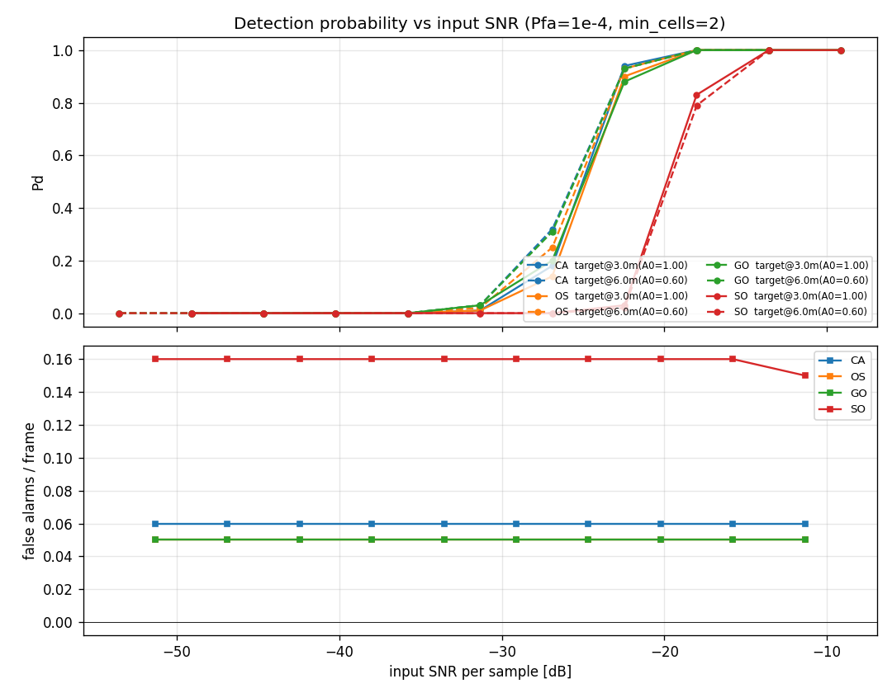
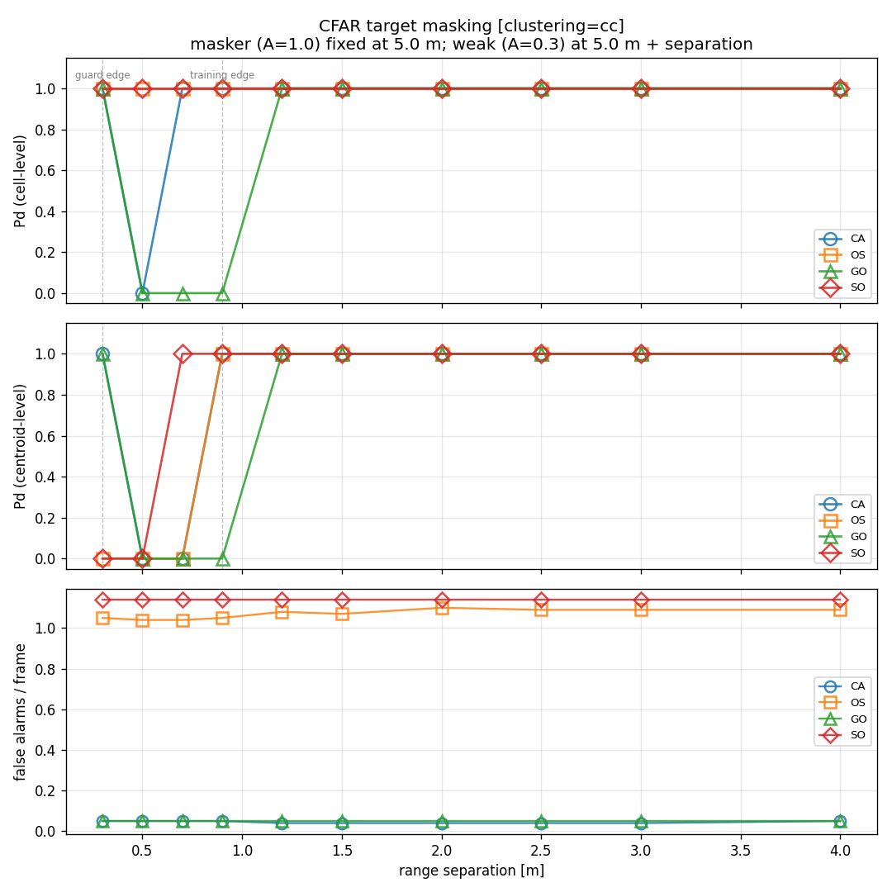
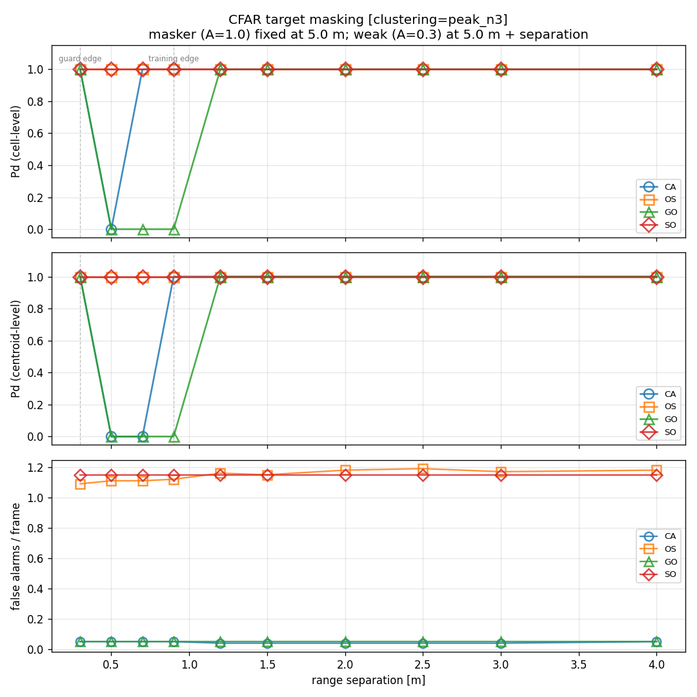

# Detection Performance Test — CFAR Methods and Clustering

**Date:** 2026-06-08
**Branch:** `feat/add-detection-test-report`
**Pipeline under test:** `range_doppler` (Hann window, DC removal) → `cfar_2d`
(empirically Pfa-calibrated) → `cluster` → discrete detections.

---

## 1. Introduction

Before a tracker can hold a target (the subject of the companion *Tracker Stress
Test* report), the **detector** must first decide which range-Doppler cells
contain a target and group them into discrete detections. That front-end is two
stages:

1. **CFAR** (Constant False-Alarm Rate) — a per-cell threshold test. For each
   cell it estimates the local noise from surrounding *training* cells and
   declares a detection if the cell exceeds `α × noise_estimate`, where `α` is
   calibrated to a design false-alarm rate (Pfa). The methods differ only in
   *how* they turn the training cells into one noise estimate.
2. **Clustering** — adjacent detected cells belonging to one target are collapsed
   into a single detection (a range-Doppler centroid).

This report characterizes the detector along the two axes of choice the
implementation exposes — **four CFAR methods** and **three clustering methods** —
under three controlled experiments:

- **Four CFAR methods** — they differ in the *noise-estimate operator* applied to
  the training cells:
  1. **CA** — Cell-Averaging: the mean of all training cells. The classic CFAR;
     optimal in homogeneous noise, but a single strong neighbour inflates the
     estimate.
  2. **OS** — Ordered-Statistic: the *k*-th ranked training cell (here the 75th
     percentile). Robust to a minority of contaminated training cells.
  3. **GO** — Greatest-Of: the **larger** of the leading/lagging (here, the four
     quadrant) training means. Suppresses false alarms at clutter edges, but
     masks a weak target next to a strong one.
  4. **SO** — Smallest-Of: the **smaller** of the training means. Resists masking
     (it ignores the contaminated side), at the cost of more false alarms.

- **Three clustering methods** — they differ in how detected cells become
  discrete detections:
  1. **`cc`** — Connected-Components: label connected blobs of detected
     cells (8-connectivity), emit one detection per blob at its centroid.
  2. **`dbscan`** — density-based: group cells by density,
     discard sparse cells as noise.
  3. **`peak`** — Peak-Picking: keep only cells that are a local maximum within a
     neighbourhood; isolates distinct peaks rather than merging blobs.

The three experiments each isolate a different detector stress:

| Experiment | What it stresses |
|---|---|
| **Amplitude sweep** | raw sensitivity — Pd vs SNR in homogeneous noise |
| **Target masking** | resolving a weak target beside a strong one (CFAR self-masking + clustering merge) |
| **Clutter edge** | detecting a target inside / beside a clutter region (CFAR clutter rejection) |

The first experiment measures the baseline each method achieves when nothing is adverse;
the second and the third experiments are where the four methods separate, and where the CA/OS/GO/SO trade-offs
above become visible numbers. Sections 3–5 take them in turn; Section 6 distils
*which method to use when*, and Section 7 records limitations.

---

## 2. Methodology

### 2.1 Fixed pipeline lens

Every experiment uses one fixed signal-processing front-end so that the CFAR (or
clustering) choice is the only variable:

| Stage | Choice | Rationale |
|---|---|---|
| Range-Doppler | Hann window, DC removal | standard; suppresses spectral leakage and the DC ridge |
| CFAR | `pfa = 1e-4`, guard `(2,4)`, training `(4,8)` | fixed design Pfa and reference geometry across all methods |
| Clustering | `min_cells = 2` | one detection per blob |

The four CFAR methods share the same guard/training geometry and design Pfa — only
the noise-estimate operator changes — so any difference in Pd or false-alarm rate
is attributable to the operator, not to a tuning advantage. The three clustering
methods all apply the `min_cells = 2` filter — a detection is dropped if its
cluster of cells numbers fewer than two. This includes `peak`: a peak detection is
sized by the blob it sits in (not counted as a single cell), so an isolated
one-cell peak is rejected just as under `cc`.

### 2.2 Empirical α calibration

Every method's threshold is `α × noise_estimate`, and `α` is what makes the design
Pfa meaningful. Rather than use the textbook closed-form `α` (which assumes
independent, exponentially-distributed cells), this implementation **calibrates α
empirically**:

- Draw pure-noise range-Doppler power maps **through the same processing chain**
  the live pipeline uses (the same Hann windowing, DC removal, and optional
  clutter removal), so adjacent cells carry the correct window-induced correlation
  and the same "dead" cells (range bin 0, the clutter-removal Doppler bin).
- Run each method's noise-estimate operator on those maps and take the
  `(1 − Pfa)` quantile of the cut/noise ratios as `α`.

This matters because the Hann window's power autocorrelation spans a few bins, so
the cells are **not** i.i.d. exponential; the analytical formulas are biased, and
SO in particular miscalibrates near the dead cells. Calibrating against the real
processing chain removes that bias. (`processing/cfar.py`, `_alpha_empirical` /
`_windowed_noise_rd_maps`; 300 calibration frames per configuration.)

### 2.3 Metrics

For each (method, sweep-position) we run N frames and report:

- **Cell-level Pd** — fraction of frames in which the target's true range-Doppler
  cell is above threshold (did the *detector* find it).
- **Centroid-level Pd** — fraction of frames in which *clustering* produced a
  detection whose centroid matches the target within **±1 range bin and ±1
  Doppler bin** (did a discrete detection survive clustering).
- **False alarms / frame** — detected centroids that match no target.

Separating cell-level from centroid-level Pd is deliberate: it tells a CFAR
*masking* failure (cell never crosses threshold) apart from a *clustering* merge
(cell detected, but absorbed into a neighbour's blob). The two have different
fixes, and §4 shows both occurring.

### 2.4 Two independent RNG streams (seed hygiene)

The detection chain draws random numbers in two separate places, and keeping their
seeds independent is what makes the measured Pfa/Pd an honest *out-of-sample*
number:

| Stream | Seeded by | Role |
|---|---|---|
| **Signal generator** | `RadarConfig.seed` (`99999`) | the noisy frame the detector works on |
| **CFAR calibration** | `_alpha_empirical(seed=0)` | the pure-noise pool used to set `α` |

If the generator drew its noise from the **same** seed as the calibration, the
threshold would be tuned in-sample to the very noise it is then applied to, and any
"empirical Pfa" measured downstream would be self-consistent with the calibration
data rather than a true measurement. The codebase guards against this by defaulting
`RadarConfig.seed` to `99999`, decoupled from CFAR's `0` (the unit tests use
`12345` to make the requirement explicit). All plots in this report use the
post-fix, decoupled streams.

---

## 3. Amplitude sweep — sensitivity in homogeneous noise

This experiment measures the baseline each method achieves when nothing is
adverse: a clean two-target scene in thermal noise, with the target amplitude
swept to trace out the Pd-vs-SNR curve.

**Scenario** (`scenario_two_targets.json`): two slow targets, one at 3 m
(+0.1 m/s, base amplitude 1.0) and one at 6 m (−0.1 m/s, base amplitude 0.6), in
homogeneous noise
(`noise_power = 1e-4`) with a small DC-leakage ridge (`leakage_amplitude = 0.02`).
The amplitude is scaled across **10 log-spaced points** (3.5e-5 → 3.5e-3), and for
each (method, scale) we run 100 frames. The x-axis is the **input SNR per sample**
`20·log₁₀(amplitude/√noise_power)`, ≈ −49 → −9 dB. The reported **Pd is
centroid-level** (post-clustering, `min_cells = 2`): with the two targets far
apart there is no clustering merge, so cell-level and centroid-level coincide and
we plot the single end-to-end number — unlike §4, where they diverge.

CMD: `python -m evaluation.sweep_amplitude --scenario scenarios/scenario_two_targets.json --frames 100`

The plot result shows, **CA, OS and GO are indistinguishable.** Their Pd curves overlap: detection climbs
from ~0 to ~1 over roughly **−35 to −18 dB** per-sample SNR (the strong 3 m target
leads the weaker 6 m target by a few dB, as Pd-vs-SNR predicts), and all three sit
at a false-alarm rate of **~0.05–0.06 per frame** — the level the empirical α
calibration targets for Pfa = 1e-4 after integration. In clean homogeneous noise
the noise-estimate operator simply does not matter: averaging, ranking, and
greatest-of all see the same well-behaved training cells.

**SO pays a real penalty for no benefit here.** The smallest-of curve is shifted
right — its 50 % point sits about **5 dB higher for the strong target and ~9 dB
higher for the weak one** (e.g. at scale 1.26e-3 the strong-target Pd is 0.83 for
SO vs 1.0 for the others; the weak target reaches Pd 1.0 only at the last grid
point, one step behind) — **and** it runs **~3× the false alarms** (0.16 vs
0.05 per frame). Both follow from "smallest-of": taking the minimum training-quadrant
mean biases the noise estimate low, so the calibrated α must be larger to hit the
design Pfa (costing sensitivity), while at the residual DC-leakage edge the
smallest-of estimate still under-reads and leaks extra false alarms. SO's
masking-resistance — its reason to exist — buys nothing when there is nothing to
mask.

In homogeneous noise, **CA is the natural default**: simplest, and
matched by OS and GO. SO is strictly worse here. The methods only separate in
SO's and OS's favour once the training environment stops being homogeneous — a
strong neighbour contaminating the training cells (§4) or a clutter edge (§5) —
which is exactly what the next two experiments introduce.

---

## 4. Target masking — a weak target beside a strong one

This experiment introduces the first **non-homogeneous training environment**: a
strong masker whose energy contaminates the weak target's training cells, and a
weak target walking toward it. It asks *how close a weak target can sit to a strong one
before the detector loses it* — and it separates two distinct ways the detector
can fail.

**Setup** (`scenario_two_targets.json` radar config; targets overridden): a
**masker** (amplitude 1.0) fixed at 5.0 m, and a **weak target** (amplitude 0.3)
at 5.0 m + *separation*, both at v = 0 — a range-only sweep. The separation is
walked over `[0.3, 0.5, 0.7, 0.9, 1.2, 1.5, 2.0, 2.5, 3.0, 4.0]` m, 100 frames per
(method, separation). For the **weak** target, both **cell-level** Pd
(did its cell cross threshold) and **centroid-level** Pd (did clustering emit a
matching detection), plus false alarms/frame. The masker's own Pd stays ~1
throughout (a sanity check). Clustering uses `cc` method.

CMD: `python -m evaluation.sweep_masking --frames 100 --clustering cc`

The top two panels separate the two failure modes: CFAR theory speaks to the cell-level Pd; the centroid-level adds the clustering question on top. The two vertical dashed lines mark the weak
target's **guard edge** and **training edge** (the masker is inside the weak
target's training window between them).

**Cell level — CFAR self-masking (top panel).** This is where the four methods
genuinely differ:
- **GO masks** the weak target exactly while the masker sits in its training
  window: cell Pd drops to **0 at 0.5–0.9 m**, recovering only at ≥1.2 m once the
  masker clears the training ring. Greatest-of locks onto the masker-contaminated
  quadrant and raises the threshold above the weak target — the textbook GO
  weakness.
- **CA** shows a milder, single-point version (cell Pd 0 at 0.5 m only) — the
  masker inflates the *averaged* estimate just enough at that one geometry.
- **OS and SO never self-mask** — cell Pd = 1.0 at *every* separation. Ranking
  (OS) and smallest-of (SO) both ignore the one contaminated side, so the weak
  cell always crosses.

**Centroid level — clustering merge (middle panel).** Even when the cell *is*
detected, `cc` merges the weak target into the masker's blob at small gaps, so no
separate centroid survives: OS's centroid Pd is **0 at 0.3–0.7 m** and SO's at
**0.3–0.5 m**, despite cell Pd = 1.0 there. With `cc`, the practical
two-target resolution floor is ~0.7–0.9 m regardless of CFAR method.

**The false-alarm cost (bottom panel).** OS and SO buy their masking-immunity
dearly: **~1.05 (OS) and ~1.15 (SO) false alarms per frame**, versus **~0.05 for
CA and GO** — roughly **20×**. Near a strong target their permissive noise
estimates (a low rank, the smallest quadrant) read the masker's skirt as noise and
spawn detections around it.

Re-running the sweep with
`peak` clustering **recovers OS and SO down to 0.3 m** —
peak-picking keeps both local maxima instead of fusing the blob, so their
centroid Pd becomes 1.0 at *every* separation. But `peak` leaves **GO unchanged**
(its cell never crosses — a CFAR failure no clustering can repair) and does not
rescue **CA** at 0.7 m either. So the lever depends on the failure: a *merge* is
fixed by the clustering stage (`peak`), a *mask* only by the CFAR stage (avoid GO).

CMD: `python -m evaluation.sweep_masking --frames 100 --clustering peak`

The middle panel makes the split visible: OS and SO snap to centroid Pd = 1.0 at
every separation (the `cc` merge is gone), while CA and GO keep the same dips as
under `cc` — their failures are upstream of clustering. The false-alarm panel is
essentially unchanged from `cc` (OS/SO ~1.1, CA/GO ~0.05), since clustering does
not alter what the CFAR stage detects.

**The third clustering method, `dbscan`, offers no peak-like middle ground.**
Sweeping its `eps`: at `eps = 1.0` and `1.5` it is *indistinguishable from `cc`*
(OS recovers at 0.9 m, SO at 0.7 m — same merges, same floor), and shrinking
`eps` to 0.5 does **not** separate the pair like `peak` — it drops the weak
target's cells as density-noise at *every* separation (centroid Pd = 0 throughout,
even at 4 m, though the false-alarm count also falls to ~0). So `eps` only trades
blob-*merging* (eps ≥ 1, like `cc`) against wholesale *discarding* (small eps,
target lost); no value recovers what `peak` does. For resolving close targets,
`peak` is the clustering lever — `dbscan` is not.

  cc (connected-components) — grouping by adjacency.
  - Theory: it labels connected blobs of above-threshold cells and emits one centroid per blob. So two targets whose detection cells touch (8-connected) are merged into a single detection.
  It can only resolve them once a gap of undetected cells separates the two blobs.
  - Measured: §4 — merges the weak + masker until they're far enough to form disconnected blobs (centroid recovers at OS 0.9 m, SO 0.7 m). ✓ Exactly the connectivity-floor behavior theory
  predicts.

  peak (peak-picking) — local-maximum extraction.
  - Theory: it keeps a cell only if it's the local maximum in a neighbourhood, so each target contributes its own peak even if their detection regions are connected — as long as there's a
  dip between them. It should therefore resolve closer than cc.
  - Measured: §4 — resolves OS/SO down to 0.3 m (every separation), well inside cc's floor. ✓ With the right nuance: it still can't conjure a peak where CFAR didn't detect (GO's masked
  cells), and it fails the one CA-at-0.7 m geometry where the weak target isn't a distinct local max — both consistent with "needs an above-threshold local maximum to pick."

  dbscan (density-based) — grouping by density, with noise rejection.
  - Theory: it groups cells within eps that meet min_samples, and labels sparse cells as noise. Large eps → merges everything nearby (like cc); small eps → clusters fragment, and a blob too
  sparse to meet min_samples is discarded. Crucially, it's a grouping method like cc, not a maximum-finder — so it should not reach peak's resolution.
  - Measured: eps=1.0/1.5 ≡ cc (merge); eps=0.5 drops the weak target as density-noise at every separation. ✓ Matches DBSCAN's design exactly — with one honest nuance: the reason small-eps
  discards rather than resolves is specific to the weak target (amplitude 0.3 → a sparse blob); shrinking eps enough to split it from the masker also pushes it below min_samples. For two
  comparable-strength targets (both dense blobs), DBSCAN at a suitable eps would resolve them — so "dbscan can't resolve" is really "dbscan can't resolve a sparse target next to a strong
  one," which is itself textbook density-clustering behaviour.

  The unifying expectation, confirmed: cc and dbscan are both partitioning/grouping clusterers — they assign each detected cell to a group and therefore merge spatially-adjacent detections.
  peak is the only maximum-extractor, and theoretically the only one of the three that can separate two connected detection regions into two points. So the predicted resolution ordering is
  peak > cc ≈ dbscan(large-eps) > dbscan(small-eps, discards) 

**Takeaway.** To resolve a weak target next to a strong one: **don't use GO** (it
masks across the whole training window). **OS or SO + `peak` clustering** resolves
the closest (down to 0.3 m) but at ~20× the false-alarm rate — acceptable only if
a downstream stage (clustering's `min_cells`, tracking confirmation) can absorb the
clutter. **CA with `cc`** is the balanced middle: ~0.05 FA/frame and a ~0.9 m
resolution floor, with only a one-point dip at 0.5 m.
