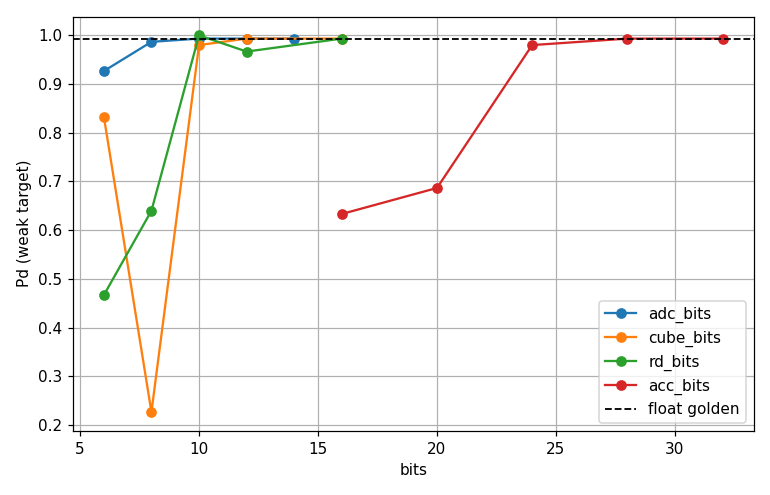
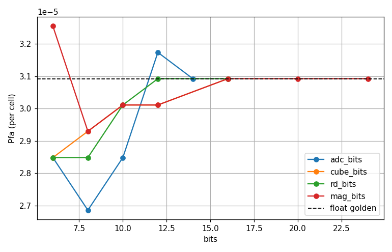
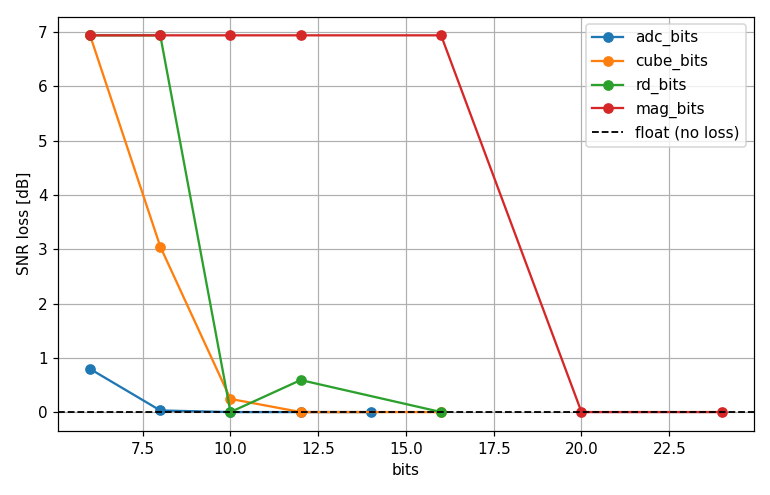
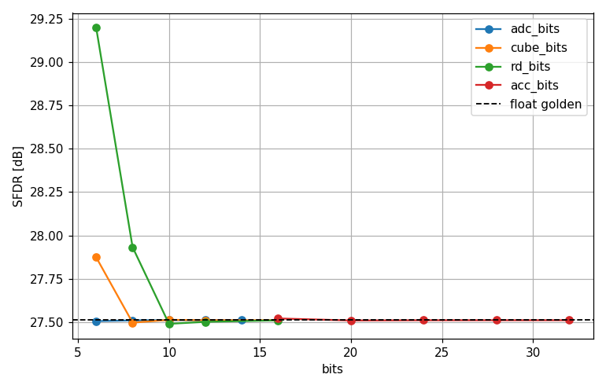

# Fixed-Point MIMO Front-End — Evaluation Report

**Pipeline stage under test:** the MIMO detection front end (ADC → range-Doppler → non-coherent integration → CFAR input)
**Fidelity:** boundary quantization (stages compute in float with values re-gridded at boundaries)
**Golden reference:** the float pipeline (`fp=None`)

---

## 1. Introduction

This study exercises an
opt-in fixed-point mode on our own MIMO front end to show the realistic process:
which steps go fixed-point, how each step's bit width is chosen, and what it
costs against the float reference. The result is an early estimate of how many bits each stage needs, not the exact,
final check that would run before committing a design to hardware, §5 lists the
limitations.

The evaluation uses one **dynamic-range scene**
(`scenarios/scenario_mimo_fixedpoint_dynrange.json`): a strong close-in return
together with a weak, distant, off-boresight target that sits just above the float
detection threshold. This is the hard case for finite precision — the strong return
sets the quantization scale, so the weak target is the first thing lost as bits are
starved.

Each candidate bit width is judged against the float pipeline by a set of metrics:

**Primary (the operational gate):**
- **Pd** — weak-target detection probability; must drop by ≤ 2 percentage points vs float.
- **Pfa** — false-alarm rate; must stay ≤ 2× the float baseline at the same CFAR threshold.

**Supporting:**
- **SNR loss** — drop in the weak target's output SNR from quantization; the per-stage bit budget.
- **SFDR** — spurious-free dynamic range (worst quantization spur vs the dominant signal).
- **ADC saturation** — pass/fail: the strong return must stay within the ADC full-scale.

## 2. Implementation

The front end is quantized at five boundaries as following, everything else (the FFT butterflies,
the CFAR sliding-window arithmetic, the whole back end) computes in float.

```
generate_frame_mimo            ← ideal "analog" truth, UNCHANGED (no fp here)
   │   complex (n_virtual, n_chirps, n_range)
   ▼ [Q_adc]   digitizer: complex I/Q → adc_bits, FIXED scale ±adc_full_scale (clips)
   │
   ├─ per virtual channel: range_doppler(fp)   (float64 inside)
   │     DC-removal · Hann · range FFT · keep n_range//2
   │        [Q_cube]  range-FFT output → cube_bits        ← radar-cube storage word
   │     clutter-removal · Hann · Doppler FFT · fftshift
   │        [Q_rd]    Doppler-FFT output → rd_bits
   │
   ▼ integrate(fp):  Σ_v |rd_v|²
   │     [Q_mag]  each |rd_v|² → mag_bits
   │     [Q_acc]  running sum  → acc_bits   (the integrated power map = CFAR input)
   │
   ▼ CFAR  (float compute on the quantized integer power map; output = boolean mask)
   │
   ▼ detection list → DoA · clustering · CTRV-EKF tracking     ← FLOAT, untouched
```

| Knob | Boundary | Hardware analog |
|------|----------|-----------------|
| `adc_bits` (+ `adc_full_scale`) | `Q_adc` (digitizer) | 12–16-bit ADC |
| `cube_bits` | range-FFT output | 16-bit I/Q radar cube (SRAM-dominant) |
| `rd_bits` | Doppler-FFT output | derived (≈ cube word + FFT bit growth) |
| `mag_bits` | per-channel power `abs(rd_v)²` | derived (≈ 2× the `rd` word) |
| `acc_bits` | NCI accumulator | 32–40-bit accumulator |

The ADC uses a **fixed** full-scale, sized to contain the strong return (an
over-range input would clip, but here the strong return sits at full-scale and
does not — so saturation is a checked guard, not a triggered effect); the internal
stages default to **per-frame block scaling**
(a block-floating-point exponent at frame granularity, applied at the boundary).
CFAR consumes the quantized integer power map and emits a boolean mask, so it is
fixed-point at its input boundary but not quantized internally (no knob).

Fixed-point has two failure modes, split here by boundary. **Overflow** at the
MSB (Most Significant Bit) end is bounded by construction — the ADC's fixed
full-scale, per-stage block scaling, and the accumulator's bit-growth headroom
(§3) — so it never triggers in this scene. What remains free to vary is
**quantization / underflow** at the LSB (Least Significant Bit) end, the weak
target dropping below the LSB, which is what the §3 sweeps study.

## 3. Per-stage evaluation

**Goal.** Determine each swept stage's *knee* — the fewest bits at which the
front end still matches the float pipeline — and identify which metric binds each
stage. Four of the five boundaries are swept (`adc`, `cube`, `rd`, `mag`); the
NCI accumulator (`acc`) is held wide and not swept. An accumulator that
sums `K` magnitude terms needs `mag_bits + ceil(log2(K))` bits to hold the sum
without losing the LSBs the `mag` stage already paid for, so its width is a
derived headroom requirement rather than an independent precision knob with its
own knee. Each swept stage is run across a bit range while the others are held wide
(≈float), so every curve isolates that one stage's cost; statistics are
Monte-Carlo over `element_noise_seed`. The dashed line in each figure is the
float-golden value, the plateau a stage should approach as bits increase. All four
figures are produced by one run:

CMD: `python -m evaluation.fixedpoint_sweep`



**Pd is the binding metric.** Pd is the weak-target detection rate on the
dynamic-range scene, gated per frame at the moving target's cell. The **ADC** stage
shows a clean Pd knee — its fixed full-scale means too few bits push the weak target
below the LSB. The block-scaled internal stages behave differently from one another:
`rd` recovers by ~10 bits, while `cube` and `mag` carry their own binding limits: The cube Pd curve is non-monotonic (8 bits scores worse than 6), and the mag Pd curve recovers only at ~20 bits — double every other stage. Each is a clue to a binding constraint the plots don't directly measure, will discuss in §3.1 and §3.2.



**Pfa is a bit-robust sanity check.** Pfa is the classical false-alarm rate,
measured on a **noise-only companion** (same config and seeds, targets removed). It
holds at the **designed (constant) false-alarm rate** across *all* bit widths — CFAR
sets its threshold from the local noise, so quantizing the noise does not move the
rate — so Pfa confirms
quantization does not break the false-alarm calibration but **does not constrain the
bit width** (the flat curve hugging the golden line). The bit-dependent false-alarm
cost lives in spur flooding instead (§3.1).



SNR loss is how far the weak target's output SNR falls below the float pipeline —
the dB "budget" view of the detection cost. The curves top out at ~7 dB — the target's entire float
SNR — so that plateau means it is fully buried. The curve largely
**mirrors Pd**: both track the weak target being lost as bits are starved, and the
knees agree — `adc` recovers by ~8 bits, `cube` by ~10, `mag` only by ~20 (its
power-domain span, §3.2). It is **clamped at 0** — quantization cannot improve SNR,
so a negative reading would only be a noise-floor-estimator artifact (where Pd, not
SNR, is the real truth).



**SFDR** is the dominant (strong) return's peak minus the largest spur outside the
target gates. **The flat ~27 dB floor is the strong target's own range leakage** — a
deterministic windowing/processing artifact ~2 range bins from the peak (≈ −27 dBc),
not a quantization spur. So SFDR is **bit-independent** here: quantization spurs stay
below that leakage floor across the usable bit range, so adding bits does not move
it. The lone exception — `mag` at 6–8 bits spiking to ~190 dB — is a degenerate
artifact, not a clean spectrum: coarse power-domain quantization drives every
non-target cell below the LSB to zero, and a zeroed cell reads the −120 dB numerical
floor (`power_db = 10·log10(power + 1e-12)` with `power = 0`). So the "largest spur"
is that floor and SFDR jumps to a huge value. The weak target is already lost there
(Pd ≈ 0).

Taken together, the four figures say Pd is what binds, Pfa is bit-robust, SNR
loss mirrors Pd, and SFDR is leakage-limited. They also show two **oddities** the
metrics alone don't explain: the **cube** Pd curve is non-monotonic (8 bits scores
worse than 6), and the **mag** Pd curve recovers only at ~20 bits — double every other stage.
Each is a clue to a binding constraint the plots don't directly measure; the next
two subsections run them down.

### 3.1 Strong-return spur flooding (the cube-stage bit-driver)

The cube Pd curve dips from 6 to 8 bits — scoring *worse* with more bits. That looks
backwards, but no real detection is lost: at 6 bits the weak target is already buried,
and its "Pd" is entirely spurious padding. At 6 bits the coarsest quantization (largest
step → tallest signal-correlated spurs) generates the most strong-return spurs, some of
which land in the weak-target gate and inflate its "Pd"; going to 8 bits strips those
spurs away, so the padded count falls before the weak target is genuinely detected
(~10 bits) and Pd recovers for real. The 6→8 dip is that padding being removed, not
detections being lost. Measuring the false-alarm rate directly confirms it.

The false-alarm cost that *does* vary with bit width comes from the **signal**, not
the noise: the strong return's quantization spurs cross the CFAR threshold and flood
the map with spurious detections. It exists only with the strong return present, so it is
measured as the **spurious-detection rate** in target-free cells of the
dynamic-range scene (excluding a guard around both moving targets) — a distinct
quantity from the classical (noise-only) Pfa above. Sweeping `cube_bits` with the
other stages held wide (Monte-Carlo over seeds) gives the spurious-detection rate:

| `cube_bits` | spurious-detection rate | vs float |
|---|---|---|
| float | 1.6e-5 | 1× |
| 6 | 8.7e-2 | ~5300× |
| 8 | 6.1e-3 | ~370× |
| 10 | 1.9e-5 | ~1× |
| 12 / 16 | ~3e-5 | ~2× |

Reproduce: `strong_return_spur_rate(cfg, targets, fp)` in
`evaluation/fixedpoint_sweep.py`.

So the **cube** word length is bound at **≥ 10 bits by spur flooding**, even though
its Pd knee alone would allow fewer. Note that **SFDR does not surface this**: SFDR
(peak spur vs the strong target) stays ~27 dB while flooding, because what matters
operationally is the spur level vs the *detection threshold* (~60 dB below the
strong target), not vs the strong target — so the spurious-detection *rate* is the
right measure, not the peak-spur ratio.

### 3.2 Power-domain quantization (the mag-stage bit-driver)

The mag Pd curve recovers only at ~20 bits — twice the others. The power domain
explains the cost.

`mag_bits` quantizes **power** (`abs(rd)²`) linearly, and a linear word delivers
only half the dynamic range per bit for power as for a voltage/amplitude quantity:
~3 dB/bit (`10·log10 2`) versus ~6 dB/bit (`20·log10 2`). The scene's dynamic range
in dB is unchanged — it is ~60 dB either way (strong/weak amplitude 0.3/0.00025 →
61.6 dB, identical in power) — but because power is the square, the
*linear* ratio that must be stored squares (voltage ratio 2¹⁰ → power ratio 2²⁰), so
it takes twice as many bits. A 16-bit power word therefore spans only ~48 dB: once
the strong return sets the block scale, the weak target's power (~60 dB down) falls
below the LSB and is lost — Pd stays ~0.6 through 16 bits and recovers only at
**~20 bits** (~60 dB), as the `mag_bits` sweep shows. The power domain needs
roughly **twice** the word length of the voltage stages (`cube`/`rd`, ~10 bits) for
the same dynamic range.

### 3.3 Bit widths chosen

Reading each stage's knee off the sweeps — the fewest bits that meet the criterion.
The §1 Pfa gate is bit-robust (satisfied everywhere), so the operative gates are
**Pd** and the **spurious-detection rate** (§3.1) — `cube` is set by the latter.

| stage | bits | bound by |
|---|---|---|
| `adc` | ~8 | Pd (weak-target loss) |
| `cube` | ~10 | spurious-detection rate (spur flooding, §3.1) |
| `rd` | ~10 | Pd |
| `mag` | ~20 | Pd (power-domain, §3.2) |
| `acc` | 32 | — (held wide; not swept) |

The **mag** word dominates the cost — quantizing *power* needs roughly twice the
bits of the others for the same dynamic range — and the **cube** word is set by
false alarms, not detection. The accumulator was held wide throughout, so its own
knee is left for future work.

## 4. Memory benefit (analytic)

The radar cube for this scenario is `n_virtual × n_chirps × (n_range/2)` =
12 × 64 × 128 = 98 304 complex samples. Storage at the swept `cube_bits` vs the
float prototype (computed by `processing.fixed_point.cube_bytes`, 2 components/sample):

| Cube word (per I/Q component) | Cube size | Saving vs float64 | Saving vs float32 |
|---|---|---|---|
| 64-bit (complex128 prototype) | 1536 KiB | 1× | — |
| 32-bit (complex64) | 768 KiB | 2× | 1× |
| 16-bit | 384 KiB | 4× | 2× |
| 12-bit | 288 KiB | 5.3× | 2.7× |
| 10-bit | 240 KiB | 6.4× | 3.2× |

This is an **analytic word-length → storage** translation, it quantifies the
radar-cube SRAM saving the chosen word lengths imply.

## 5. Scope & limitations

The methodology (fixed/float split, quantize-in-float, sweep-against-golden,
Pd-primary knee) is standard first-pass practice, but boundary quantization
makes the recommended bit widths **lower bounds** and the savings **upper bounds**,
and a few further choices bound the scope:

1. **The scaling policy is assumed, not compared.** All sweeps use one number-format
   choice — fixed-scale ADC plus per-frame BFP on the internal stages
   (`scaling='block'`). The code also supports a static global scale
   (`scaling='fixed'`, plain Q-format), but it is not compared, so the recommended
   widths are **conditional on BFP**; whether a static Q-format or BFP better fits
   this pipeline is a question this study hasn't answered yet.
2. **The FFT is computed in float, not fixed-point.** A bit-true fixed-point FFT is
   a substantially larger, more involved implementation — per-stage bit growth and
   rescaling, quantized twiddle factors, quantized window coefficients (a separable
   pre-FFT multiply, minor effect) — so for this first-pass study it is deliberately
   left in float and deferred to a bit-true sign-off. Consequence: the
   `cube_bits`/`rd_bits` knees assume ideal FFT arithmetic and are optimistic by
   perhaps a bit or two.
3. **The signal model is clean** (no PA nonlinearity / phase noise), so the only
   added spur *sources* are quantization — but the **SFDR floor here is set by the
   strong target's own range leakage**, not quantization (§3). So SFDR mainly
   confirms that quantization stays below that leakage floor; read it that way, not
   as an absolute spur level.

## 6. Artifact index

| Artifact | Source |
|---|---|
| `fixedpoint_pd_vs_bits.png` | `evaluation/fixedpoint_sweep.py` (`main`) |
| `fixedpoint_pfa_vs_bits.png` | `evaluation/fixedpoint_sweep.py` (`main`) |
| `fixedpoint_snrloss_vs_bits.png` | `evaluation/fixedpoint_sweep.py` (`main`) |
| `fixedpoint_sfdr_vs_bits.png` | `evaluation/fixedpoint_sweep.py` (`main`) |
| `scenarios/scenario_mimo_fixedpoint_dynrange.json` | the dynamic-range scene |
| fixed-point mode | `processing/fixed_point.py`, `FixedPointConfig`, `fp=` on `range_doppler`/`integrate`/`process_mimo_frame` |
