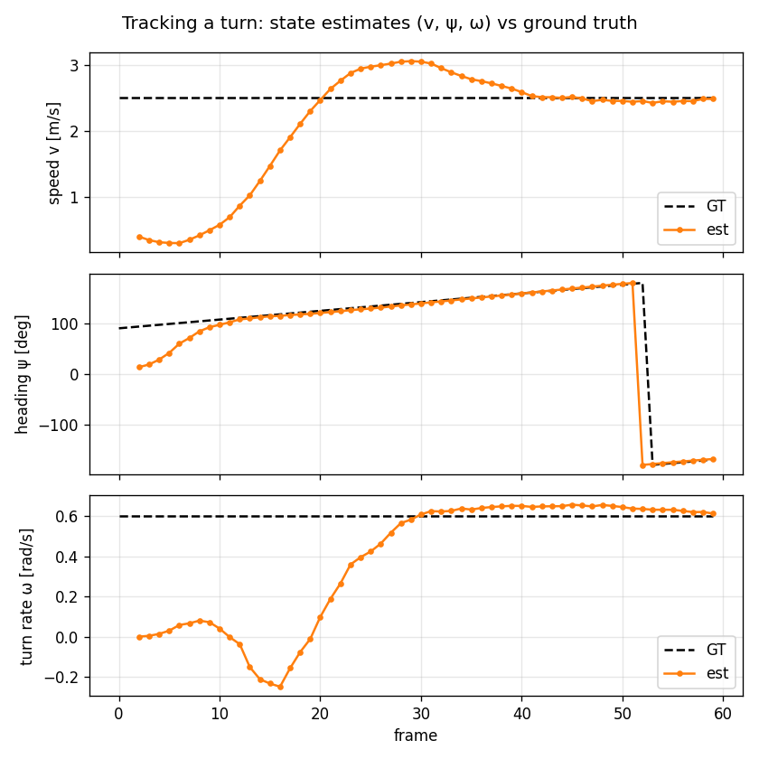
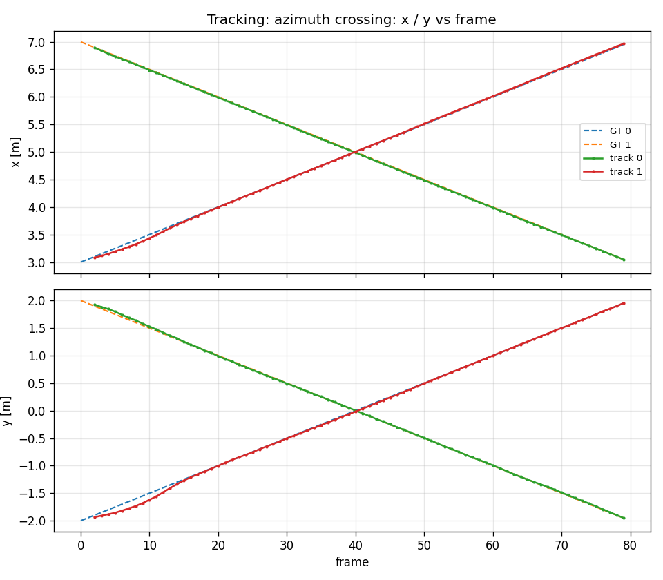

# MIMO Evaluation Report

**Date:** 2026-06-23
**Pipeline:** TDM-MIMO →
per-channel range-Doppler FFT → non-coherent integration → 2-D CFAR → DoA at detected cells → Cartesian point cloud → DBSCAN clustering → tracking.

---

## 1. Introduction
Extend the SISO to MIMO: 3 TX × 4 RX = 12-element λ/2 virtual ULA. The pipeline under MIMO overlaps partly with the pipeline under SISO, here only introduce/evaluate the steps which are changed or newly added. Four evaluation facets are: detection, angle (DoA), clustering, tracking. 

- **non-coherent integration (NCI):** NCI adds SNR and changes the noise *distribution* from
  exponential to `Gamma(N_virtual)` (`N_virtual = n_tx·n_rx`). This is handled by recalibrating the CFAR threshold α
  for the integration count.
- **TDM Doppler compensation:** sequential TX firing imprints a Doppler-dependent
  phase across the virtual array (it would bias the angle estimate); it is removed
  using the cell's measured Doppler bin `d` (after CFAR, before DoA):
  `exp(-j2π(d − n_chirps/2)·i_tx/(n_chirps·n_tx))` per element, `i_tx ∈ {0, 1, …, n_tx−1}`.
- **DoA estimation:** Bartlett / Capon / MUSIC / ESPRIT
- **Clustering:** `peak`/`cc` are grid/image operations that do not
  apply to a scattered Cartesian point cloud; only DBSCAN remains.
- **2D tracking:** CTRV-EKF (CTRV: Constant Turn Rate and Velocity)

Real-time streaming pipeline see `streaming_publisher.py` and `streaming_subscriber_pointcloud.py`.

## 2. Signal model

The generator is the existing FMCW model extended to MIMO in **one class**: the
per-target range/Doppler physics is shared, and a MIMO entry point
(`generate_frame_mimo`) adds a **channel axis** plus a per-element **steering phase**.
For the TDM 3 TX × 4 RX array the 12 transmit–receive pairs form a 12-element λ/2
**virtual ULA**; element *e* at position `pos_e` (in wavelengths) carries the phase
`exp(j2π·pos_e·sin θ)` for the target azimuth θ. The TX fire **sequentially** (TDM), so
each TX is seen every `n_tx` chirps — which divides the unambiguous velocity by `n_tx`
and adds a Doppler-dependent phase across TX that the DoA stage compensates (using the
cell's measured Doppler bin) before angle estimation.

**Within-frame azimuth assumption.** The steering phase uses a single, **frame-start**
azimuth held **constant across all chirps and TX within a frame**; it updates only
frame-to-frame. So within-frame angular migration is neglected — the standard
**constant-DOA-per-CPI** assumption, consistent with the existing **stop-and-hop** model
(constant velocity within a frame for range/Doppler). It is accurate because a frame is
short (here 64 chirps × 50 µs ≈ 3 ms), over which a target's bearing changes negligibly.

**Per-element noise — a dedicated RNG stream.** MIMO draws thermal noise
**independently per virtual element**, from its own RNG stream (`element_noise_seed`,
default 33333) — a fifth stream decoupled from the thermal-noise (`seed`), Swerling
fluctuation, clutter, and extent streams. It is **frame-addressed**: each element's noise
is keyed by `(element_noise_seed, frame_index, element_index)`, so it is **pure** —
reproducible regardless of the order frames/elements are generated, unlike the legacy
call-ordered single-channel draw. The single-channel path (`generate_frame`, `N_virtual = 1`)
keeps its original call-ordered draw **unchanged**, so prior single-channel reports
reproduce byte-for-byte; the MIMO path uses the new stream, so adding channels never
perturbs the `N_virtual = 1` result.

## 3. Detection
### 3.1 NCI gain

On a single moving-target scenario (`scenario_mimo.json`), object detection probability
(Pd) is plotted against per-channel SNR, comparing a single channel (N_virtual=1) with
the 12-channel non-coherent integration. A detection counts only if a CFAR cell falls near
the ground-truth cell in **both** range and Doppler (the 2-D match rejects scattered
false alarms that would otherwise inflate Pd at low SNR), and the GT cell is recomputed
per frame because the target moves.

CMD: `python -m evaluation.mimo_detection_eval`

In the transition region — where the single channel's Pd drops from ~1 to 0 — it has
already fallen to ~0.65 (and to 0 by noise power 0.2), while the 12-channel integration
still detects at ~0.9. The integrated curve
detects reliably ~**6 dB** further down in SNR than the single
channel — the NCI processing gain (the ideal for N_virtual=12 is 10·log₁₀12 ≈ 10.8 dB; the
realized shift is smaller because Pd is steep and the single channel already benefits
from the FFT processing gain). The x-axis is *pre-FFT per-channel* input SNR, hence the
negative dB values; what matters is the **shift** between the two curves.

### 3.2 False alarm cluster in near-DC region

Experiments show that in the later clustering stage, a persistent false-alarm cluster appears near the range-0 / high-velocity corner. It is
**noise-driven**, not leakage or a target artifact: noise-only frames (no targets, and
`leakage_amplitude = 0`) reproduce the *identical* cluster. The cause is a **CFAR
training-window edge effect** rooted in `dc_removal`: for a cell a few bins from DC, the
training ring includes the DC bins that `dc_removal` zeros, and at the range-0 boundary
CFAR's edge replication (`mode="edge"`) copies those zeroed cells further into the
window — both deflate the local noise estimate → locally-too-low threshold → elevated
local Pfa.

It is worse under MIMO because **non-coherent integration concentrates it**: integration
averages away the *random* part of the noise estimate but not the *systematic* edge
bias, and tightens the noise distribution (exponential → Gamma(N_virtual)), so the contiguous
over-firing band fires together as one cluster. Measured near-DC false alarms rise from
~0.33/frame (single channel, scattered) to ~1.27/frame (N_virtual=12, clustered), while the bulk
false-alarm rate stays near nominal under the α-recalibration.

**Fix (applied):** a min-range gate drops the first few range bins on the MIMO path; the single-channel reports keep their bin-0
notch unchanged for byte-for-byte reproducibility.

## 4. DoA estimation

The angle stage turns the per-cell virtual-array snapshot into an azimuth. Four
estimators are compared — **Bartlett** (conventional beamformer / angle-FFT), **Capon**
(MVDR), **MUSIC**, and **ESPRIT** (search-free) — along the two axes that matter:
**accuracy** (§4.1 — how precisely one source's angle is estimated) and **resolution**
(§4.2 — how close two sources can be and still be separated). Both studies use
**synthetic array snapshots** with the SNR and source angle(s) set directly, without
scenario file — the standard DoA benchmark, which isolates angle estimation from
detection and clustering.

### 4.1 Accuracy vs SNR

CMD: `python -m evaluation.mimo_doa_eval`

Azimuth RMSE vs SNR for a single source at 12.4° on the 12-element ULA (Monte-Carlo
over trials). All four estimators improve with SNR and are comparable for a single
source. The grid methods (Bartlett/Capon/MUSIC, 1° search grid) **floor at ~0.4°** —
their quantization limit — while **ESPRIT** (search-free) keeps improving to ~0.04° at
30 dB. *Super-resolution's advantage for a single source is small; its real payoff is
resolution (§4.2).*

### 4.2 Angular resolution

CMD: `python -m evaluation.mimo_doa_eval`

Minimum separation at which two equal sources are resolved in ≥80 % of trials, swept vs
SNR. **Bartlett is flat at ~10°** — the beamwidth (Rayleigh) limit, independent of SNR.
The super-resolution estimators (Capon / MUSIC / ESPRIT) **resolve closer as SNR rises**,
crossing below Bartlett around 5–10 dB and reaching 2–5° by 30 dB; breaking the beamwidth
limit is exactly the reason to run them. The honest flip side: **at very low SNR (0 dB)
they are no better (≈14°) than Bartlett** — super-resolution is not free, it needs SNR.

For reference, at 20 dB the thresholds are Bartlett 10°, Capon 5°, MUSIC 4°, ESPRIT 3°
(≈2.5–3× closer than Bartlett).

## 5. Clustering — DBSCAN

Clustering here differs from the single-channel pipeline. There, clustering ran on the
2-D range-Doppler **mask grid** (`peak`/`cc`/DBSCAN on the image, returning range/Doppler
bins); under MIMO it runs on a **scattered Cartesian point cloud** `(x, y, v_radial)`
produced by the DoA stage. Grid/image methods (`peak`, `cc`) have no meaning on a sparse
point set, so only **DBSCAN** remains — run over `(x, y, vel_scale·v_radial)`, which folds
radial velocity into the distance metric so two objects at the same position but different
speed can still be separated.

The experiment sweeps the two knobs (`eps_m`, `vel_scale`) on the crossing frame of
`scenario_mimo_crossing` — two targets that share a position but have **opposite radial
velocity** (ground truth = 2 objects) — and reports the resulting object count.

CMD: `python -m evaluation.mimo_clustering_eval`

- **`vel_scale = 0` (spatial only) always merges to 1** — co-located targets are
  inseparable without the velocity feature.
- **`vel_scale > 0` splits to the correct 2** over a broad band (eps ≈ 0.6–1.6 m,
  vel_scale ≈ 1–2).
- **Too-large `vel_scale`** (≈4) over-splits each target's own velocity spread into
  several objects; **too-large `eps`** (≈2.4 m) re-merges.

This confirms the velocity feature is what separates same-position / different-speed
objects, with a wide, forgiving sweet spot.

**Caveat — raw radial velocity only works for point targets.** Each target here occupies
a single bearing, so its `v_radial` is one value and the velocity feature behaves cleanly.
An **extended** object — one spanning a range of bearings — is different: its radial
velocity `v·cos(ψ − θ)` varies across it (the bearing θ differs across its extent), even
though it moves as one rigid body. DBSCAN would read that spread as multiple objects and
**over-split** the single target. Handling it requires **down-weighting the velocity
feature** so the within-object spread can't fragment it, or **fitting the rigid-body
velocity profile** `v_r = v_x·cosθ + v_y·sinθ` and grouping detections consistent with a
single velocity.

## 6. Tracking — CTRV-EKF

The tracking evaluation in this section runs the full end-to-end pipeline with a fixed front end —
**CA-CFAR** detection and **MUSIC** DoA — feeding the **CTRV-EKF** tracker, whose data
association applies a **χ²₃ gate** (feasibility screen) and then **GNN** assignment. This
is the same association machinery as the radial (1-D) tracker in the earlier reports; the
gate only rises from **χ²₂ (9.21)** to **χ²₃ (11.34)** because the Cartesian measurement
`[r, θ, ṙ]` adds the azimuth dimension (2 → 3 DOF).

Note the 2-D tracker has a config `dt` (predict timestep (s)) which the previous 1-D Tracker doesn't have:
  - 1-D Tracker works entirely in bins / bins-per-frame. Its state is [range_bin, range_rate], and — crucially — it only puts position
  (range_bin) in the Kalman update; Doppler is smoothed separately (last_doppler_bin), never fed into the KF as a physical velocity. So
  everything is per-frame/bin, "one frame = one step" (Δt=1) is baked in, and it never needs a real-world time value.
  - Cartesian CTRV-EKF works in SI units (v in m/s, ω in rad/s) and feeds the m/s Doppler ṙ into the measurement update. For the
  predict's "new position = position + velocity × time" to be consistent with an m/s velocity, the timestep must be in real seconds —
  i.e. `dt` = frame_period. That's the field. It's exactly the bug we just fixed: without it the predict treated velocity as per-frame
  while the measurement was per-second.

  So `dt` is the price of working in physical units + using the real Doppler — which is more intuitive than the 1-D tracker's bins, but
  requires the tracker to know the real frame period.

### 6.1 Maneuvering (turn) target

**Scenario** (`scenario_mimo_turn.sjon`): A `ct_xy` target turning at 0.6 rad/s, tracked over 60 frames
end-to-end through the full chain. **Position RMSE = 0.24 m** with a **single stable
track ID** through the maneuver; the track follows the curved trajectory closely.

CMD: `python -m evaluation.mimo_tracking_eval --scenario scenarios/scenario_mimo_turn.json --frames 60`

The full state is recovered, not just position:

After a **convergence transient** (~25–30 frames) the estimates **settle** onto ground
truth and hold: speed **v → ~2.5 m/s** (after an overshoot to ~3.0), heading **ψ**
tracks the rotating GT line (including through the ±180° wrap), and turn rate
**ω → ~0.6 rad/s** (GT 0.6). The transient comes from the spawn seed (`ψ = bearing`,
`v = radial velocity`, `ω = 0`) — a single Doppler can't separate speed from heading at
birth, so the filter starts with a cross-range-blind guess and converges as the geometry
evolves. ω is the only state not measured directly — its measurement-Jacobian column is zero, so it's inferred solely from how the heading evolves and needs the maneuver to excite it (a non-manoeuvring or very short track would not pin it down), in the 
figure it shows the largest transient.

**Two prerequisites for this to work (both learned the hard way):**
1. **Consistent units.** The CTRV predict timestep must be the **frame period** so the
   state velocity is in m/s, matching the m/s Doppler measurement. With the earlier
   per-frame (`Δt = 1`) predict, the position dynamics and the Doppler measurement
   demanded velocities a factor of `1/frame_period` apart — an irreconcilable conflict
   that left v, ψ, ω as garbage (position still tracked, because `(r, θ)` are measured
   directly each frame and masked it).
2. **Process noise sized for the frame rate.** With `dt = frame_period`, the default
   per-step process noise is far too stiff; `ω` then crawls and under-shoots. Sizing
   `σ_a`, `σ_yaw` for the frame rate lets it converge.

*Note:* the scenario uses the same CTRV kinematics as the tracker's motion
model, so this validates "tracks a maneuver under sensor noise," **not** motion-model
robustness (CTRA-truth-vs-CTRV-filter mismatch is recorded for later).

### 6.2 Azimuth crossing

**Scenario** (`scenario_mimo_angle_crossing.json`): Two **off-boresight** targets crossing in the x-y plane:
A goes (3, −2) → (7, 2), B goes (7, 2) → (3, −2), meeting at (5, 0) near frame 40. Their
**bearings cross** (A: −34° → +16° through 0; B: +16° → −34°) and so do their y-positions
— a genuine 2-D crossing whose positions come from the **DoA/angle** stage, the MIMO
capability this exercises (a 1-D radar has no cross-range axis). Plotted as **x and y vs
frame**: both panels show the crossing as an **X**.

CMD: `python -m evaluation.mimo_tracking_eval --scenario scenarios/scenario_mimo_angle_crossing.json --frames 80`

Each target keeps a **single track ID** through the crossing — **no swap** — with
per-target RMSE ≤ 0.05 m. At the meeting point the two share (x, y) but have **opposite
radial velocity** (±1 m/s), so they fall in different Doppler cells and stay resolvable
(`n_sources=1`, no unresolved merge). The harder variant — a *same-range, same-Doppler*
crossing separable by **angle alone** (an unresolved merge the tracker must coast
through, needing `n_sources=2`) — is recorded as a tougher follow-up.

## 7. Summary

| Facet | Result |
|---|---|
| Detection | NCI gives ~6 dB Pd improvement (N_virtual=12 vs single channel); Pfa nominal post-recalibration |
| DoA accuracy | all comparable for one source; ESPRIT reaches ~0.04° at 30 dB vs ~0.4° grid floor |
| DoA resolution | ESPRIT 3° < MUSIC 4° < Capon 5° < Bartlett 10° |
| Clustering | velocity feature splits co-located targets; correct count over eps 0.6–1.6 m, vel_scale 1–2 |
| Tracking | turn tracked at 0.24 m RMSE, stable ID; full state (v, ψ, ω→0.61 vs 0.6) converges and settles after a transient |

## 8. Artifact index

| Artifact | Produced by |
|---|---|
| `mimo_detection.png` | `python -m evaluation.mimo_detection_eval` |
| `mimo_doa_accuracy.png`, `mimo_doa_resolution.png` | `python -m evaluation.mimo_doa_eval` |
| `mimo_clustering.png` | `python -m evaluation.mimo_clustering_eval` |
| `mimo_tracking_turn.png`, `mimo_tracking_turn_states.png`, `mimo_tracking_angle_crossing.png` | `python -m evaluation.mimo_tracking_eval` |
| offline runner + Cartesian scorers | `evaluation/mimo_pipeline.py` |
| scenarios | `scenarios/scenario_mimo.json`, `scenario_mimo_2targets.json`, `scenario_mimo_crossing.json`, `scenario_mimo_turn.json`, `scenario_mimo_angle_crossing.json` |
| tests | `tests/test_mimo_pipeline.py`, `tests/test_ct_xy.py` |
