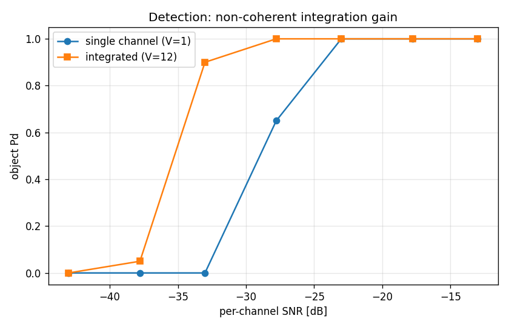
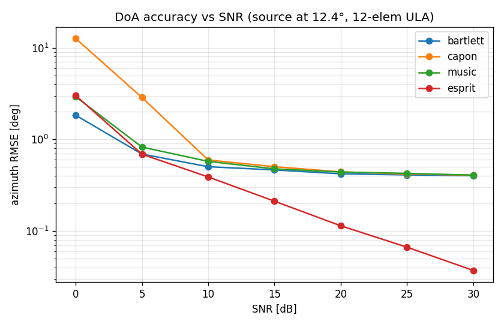
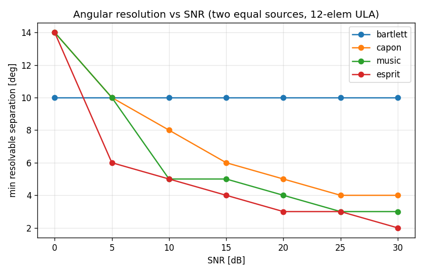
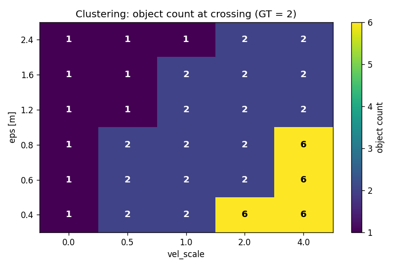
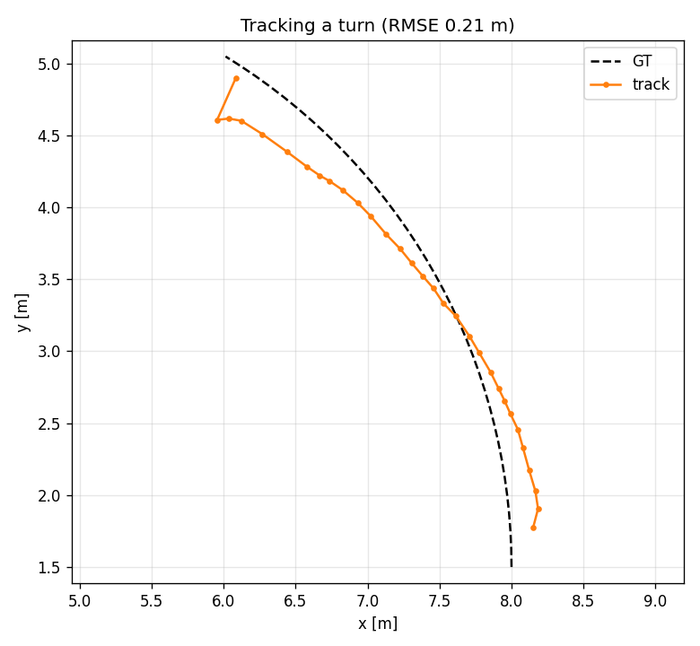
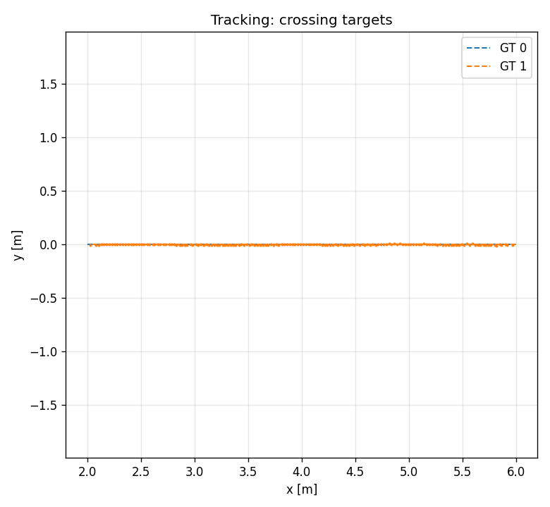

# MIMO Evaluation Report

**Date:** 2026-06-23
**Pipeline:** TDM-MIMO →
per-channel range-Doppler FFT → non-coherent integration → 2-D CFAR → DoA at detected cells → Cartesian point cloud → DBSCAN clustering → tracking.

---

## 1. Introduction
Extend the SISO to MIMO: 3 TX × 4 RX = 12-element λ/2 virtual ULA. The pipeline under MIMO overlaps partly with the pipeline under SISO, here only introduce/evaluate the steps which are changed or newly added. four evaluation facets — detection, angle (DoA), clustering, tracking. 

- **non-coherent integration (NCI):** NCI adds SNR and changes the noise *distribution* from
  exponential to Gamma(V). This is handled by recalibrating the CFAR threshold α
  for the integration count.
  So we fix one CFAR default (CA, real-time) and *verify* behaviour rather than compare.
- **DoA estimation:** Bartlett / Capon / MUSIC / ESPRIT
- **Clustering:** `peak`/`cc` are grid/image operations that do not
  apply to a scattered Cartesian point cloud; only DBSCAN remains.
- **2D tracking:** CTRV-EKF (CTRV: Constant Turn Rate and Velocity)

Real-time streaming pipeline see `streaming_publisher.py` and `streaming_subscriber_pointcloud.py`.

## 2. Signal model

The generator is the existing FMCW model extended to MIMO in **one class**: the
per-target range/Doppler physics is shared, and a MIMO entry point
(`generate_frame_mimo`) adds a **channel axis** plus a per-element **steering phase**.
For the TDM 3 TX × 4 RX array the 12 transmit–receive pairs form a 12-element λ/2
**virtual ULA**; element *e* at position `pos_e` (in wavelengths) carries the phase
`exp(j2π·pos_e·sin θ)` for the target azimuth θ. The TX fire **sequentially** (TDM), so
each TX is seen every `n_tx` chirps — which divides the unambiguous velocity by `n_tx`
and adds a Doppler-dependent phase across TX that the DoA stage compensates (using the
cell's measured Doppler bin) before angle estimation.

**Within-frame azimuth assumption.** The steering phase uses a single, **frame-start**
azimuth held **constant across all chirps and TX within a frame**; it updates only
frame-to-frame. So within-frame angular migration is neglected — the standard
**constant-DOA-per-CPI** assumption, consistent with the existing **stop-and-hop** model
(constant velocity within a frame for range/Doppler). It is accurate because a frame is
short (here 64 chirps × 50 µs ≈ 3 ms), over which a target's bearing changes negligibly.

**Per-element noise — a dedicated RNG stream.** MIMO draws thermal noise
**independently per virtual element**, from its own RNG stream (`element_noise_seed`,
default 33333) — a fifth stream decoupled from the thermal-noise (`seed`), Swerling
fluctuation, clutter, and extent streams. It is **frame-addressed**: each element's noise
is keyed by `(element_noise_seed, frame_index, element_index)`, so it is **pure** —
reproducible regardless of the order frames/elements are generated, unlike the legacy
call-ordered single-channel draw. The single-channel path (`generate_frame`, `V = 1`)
keeps its original call-ordered draw **unchanged**, so prior single-channel reports
reproduce byte-for-byte; the MIMO path uses the new stream, so adding channels never
perturbs the `V = 1` result.

## 3. Detection
### 3.1 Non-coherent integration gain

Object Pd vs per-channel SNR on `scenario_mimo`, single channel (V=1) vs the
12-channel non-coherent integration. A detection counts only if a CFAR cell falls near
the ground-truth cell in **both** range and Doppler (the 2-D match rejects scattered
false alarms that would otherwise inflate Pd at low SNR), and the GT cell is recomputed
per frame because the target moves.

CMD: `python -m evaluation.mimo_detection_eval`

Around the crossover the single channel has already fallen to ~0.65 (and to 0 by noise
power 0.2) where the 12-channel integration still detects at ~0.9. The integrated curve
detects reliably ~**6 dB** further down in SNR than the single
channel — the NCI processing gain (the ideal for V=12 is 10·log₁₀12 ≈ 10.8 dB; the
realized shift is smaller because Pd is steep and the single channel already benefits
from the FFT processing gain). The x-axis is *pre-FFT per-channel* input SNR, hence the
negative dB values; what matters is the **shift** between the two curves.

### 3.2 False alarm cluster in near-DC region

Experiments show that in the later clustering stage, a persistent false-alarm cluster appears near the range-0 / high-velocity corner. It is
**noise-driven**, not leakage or a target artifact: noise-only frames (no targets, and
`leakage_amplitude = 0`) reproduce the *identical* cluster. The cause is a **CFAR
training-window edge effect** rooted in `dc_removal`: for a cell a few bins from DC, the
training ring includes the DC bins that `dc_removal` zeros, and at the range-0 boundary
CFAR's edge replication (`mode="edge"`) copies those zeroed cells further into the
window — both deflate the local noise estimate → locally-too-low threshold → elevated
local Pfa.

It is worse under MIMO because **non-coherent integration concentrates it**: integration
averages away the *random* part of the noise estimate but not the *systematic* edge
bias, and tightens the noise distribution (exponential → Gamma(V)), so the contiguous
over-firing band fires together as one cluster. Measured near-DC false alarms rise from
~0.33/frame (single channel, scattered) to ~1.27/frame (V=12, clustered), while the bulk
false-alarm rate stays near nominal under the α-recalibration.

**Fix (applied):** a min-range gate drops the first few range bins on the MIMO path; the single-channel reports keep their bin-0
notch unchanged for byte-for-byte reproducibility.

## 4. DoA estimation

### 4.1 Accuracy vs SNR

CMD: `python -m evaluation.mimo_doa_eval`

Azimuth RMSE vs SNR for a single source at 12.4° on the 12-element ULA (Monte-Carlo
over array snapshots — the standard DoA benchmark, isolating angle estimation from
detection). All four estimators improve with SNR and are comparable for a single
source. The grid methods (Bartlett/Capon/MUSIC, 1° search grid) **floor at ~0.4°** —
their quantization limit — while **ESPRIT** (search-free) keeps improving to ~0.04° at
30 dB. *Super-resolution's advantage for a single source is small; its real payoff is
resolution (§4.2).*

### 4.2 Angular resolution

CMD: `python -m evaluation.mimo_doa_eval`

Minimum separation at which two equal sources are resolved in ≥80 % of trials, swept vs
SNR. **Bartlett is flat at ~10°** — the beamwidth (Rayleigh) limit, independent of SNR.
The super-resolution estimators (Capon / MUSIC / ESPRIT) **resolve closer as SNR rises**,
crossing below Bartlett around 5–10 dB and reaching 2–5° by 30 dB; breaking the beamwidth
limit is exactly the reason to run them. The honest flip side: **at very low SNR (0 dB)
they are no better (≈14°) than Bartlett** — super-resolution is not free, it needs SNR.

For reference, at 20 dB the thresholds are Bartlett 10°, Capon 5°, MUSIC 4°, ESPRIT 3°
(≈2.5–3× closer than Bartlett).

## 5. Clustering — DBSCAN

DBSCAN clustering on the point cloud. Object count vs (`eps_m`, `vel_scale`) on the crossing frame of
`scenario_mimo_crossing`, where the two targets share a position but have opposite
radial velocity (ground truth = 2 objects): 

CMD: `python -m evaluation.mimo_clustering_eval`

- **`vel_scale = 0` (spatial only) always merges to 1** — co-located targets are
  inseparable without the velocity feature.
- **`vel_scale > 0` splits to the correct 2** over a broad band (eps ≈ 0.6–1.6 m,
  vel_scale ≈ 1–2).
- **Too-large `vel_scale`** (≈4) over-splits each target's own velocity spread into
  several objects; **too-large `eps`** (≈2.4 m) re-merges.

This confirms the velocity feature is what separates same-position / different-speed
objects, with a wide, forgiving sweet spot. (Caveat, from the M3 spec §7a: raw radial
velocity over-splits a single *extended* object whose Doppler varies across its angular
extent; moot for the point targets here.)

## 6. Tracking — CTRV-EKF end-to-end

### 6.1 Maneuvering (turn) target

CMD: `python -m evaluation.mimo_tracking_eval`

`scenario_mimo_turn` — a `ct_xy` target turning at 0.6 rad/s — tracked end-to-end
through the full chain. **Position RMSE = 0.21 m** with a **single stable track ID**
through the maneuver. The track follows the curved trajectory closely after a brief
spawn transient.

**Honest finding — turn rate ω is only weakly observable.** Although position tracking
is excellent, the estimated turn rate does **not** converge to the true 0.03 rad/frame
end-to-end: it *wanders* with the DoA noise (≈0.09 at 35 frames, 0.02 at 50, −0.19 at
70). ω is not directly measured (its measurement-Jacobian column is zero) — it is
inferred only from how the heading evolves, and a single target's noisy (r, θ, ṙ)
stream constrains it weakly. The M4 unit test converges ω to within 0.025 because it
feeds *noiseless* synthetic measurements; the gap here is precisely the azimuth-noise
sensitivity. Pinning ω down would need lower azimuth noise, a longer stable-geometry
arc, or multiple scatterers (extended-object tracking, a future direction).

*Methodology note:* the scenario uses the same CTRV kinematics as the tracker's motion
model, so this validates "tracks a maneuver under sensor noise," **not** motion-model
robustness (CTRA-truth-vs-CTRV-filter mismatch is recorded for later).

### 6.2 Crossing targets

CMD: `python -m evaluation.mimo_tracking_eval`

`scenario_mimo_crossing` — two constant-velocity targets crossing at the origin —
tracked over 80 frames; both confirmed-track trajectories follow their ground truth
through the crossing.

## 7. Summary

| Facet | Result |
|---|---|
| Detection | NCI gives ~6 dB Pd improvement (V=12 vs single channel); Pfa nominal post-recalibration |
| DoA accuracy | all comparable for one source; ESPRIT reaches ~0.04° at 30 dB vs ~0.4° grid floor |
| DoA resolution | ESPRIT 3° < MUSIC 4° < Capon 5° < Bartlett 10° |
| Clustering | velocity feature splits co-located targets; correct count over eps 0.6–1.6 m, vel_scale 1–2 |
| Tracking | turn tracked at 0.21 m RMSE with stable ID; ω weakly observable (does not converge end-to-end) |

## 8. Artifact index

| Artifact | Produced by |
|---|---|
| `mimo_processing_frame_view.png`, `mimo_superresolution.png` | `python -m evaluation.mimo_demo` |
| `mimo_detection.png` | `python -m evaluation.mimo_detection_eval` |
| `mimo_doa_accuracy.png`, `mimo_doa_resolution.png` | `python -m evaluation.mimo_doa_eval` |
| `mimo_clustering.png` | `python -m evaluation.mimo_clustering_eval` |
| `mimo_tracking_turn.png`, `mimo_tracking_crossing.png` | `python -m evaluation.mimo_tracking_eval` |
| offline runner + Cartesian scorers | `evaluation/mimo_pipeline.py` |
| scenarios | `scenarios/scenario_mimo.json`, `scenario_mimo_2targets.json`, `scenario_mimo_crossing.json`, `scenario_mimo_turn.json` |
| tests | `tests/test_mimo_pipeline.py`, `tests/test_ct_xy.py` |

Design: `docs/superpowers/specs/2026-06-23-m5-cartesian-evaluation-design.md`.
