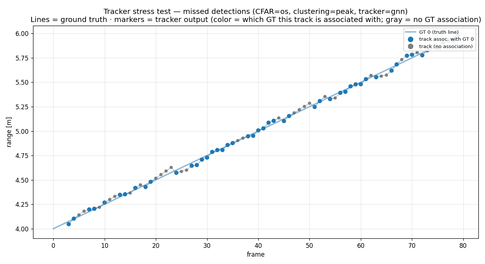
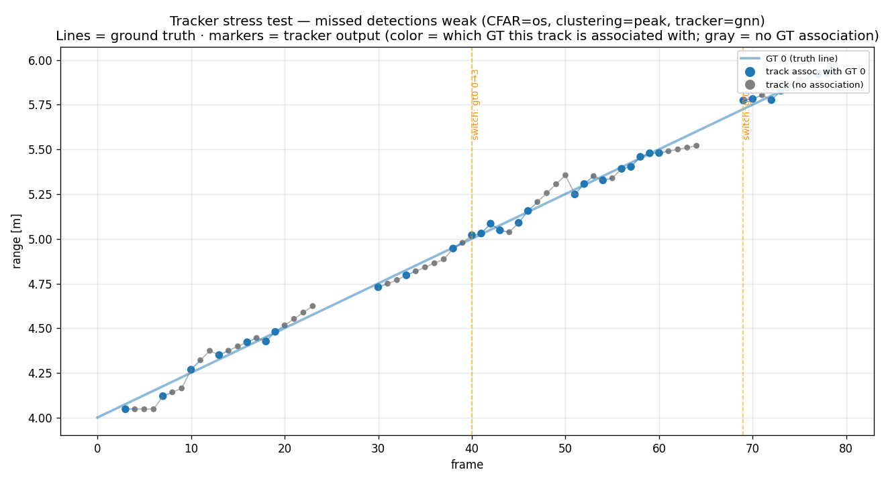
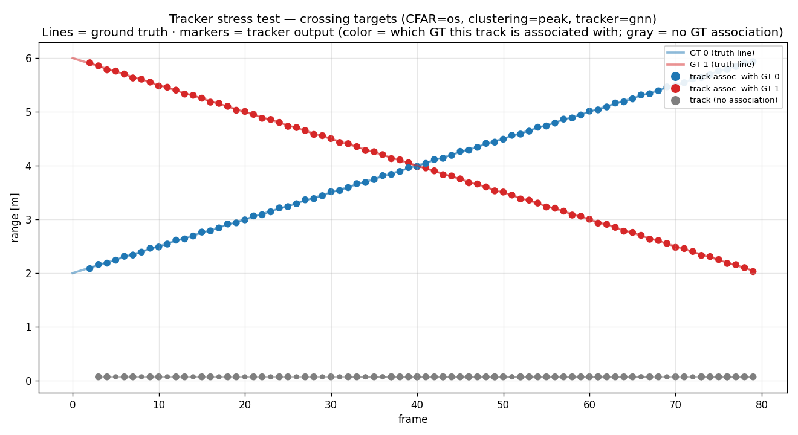
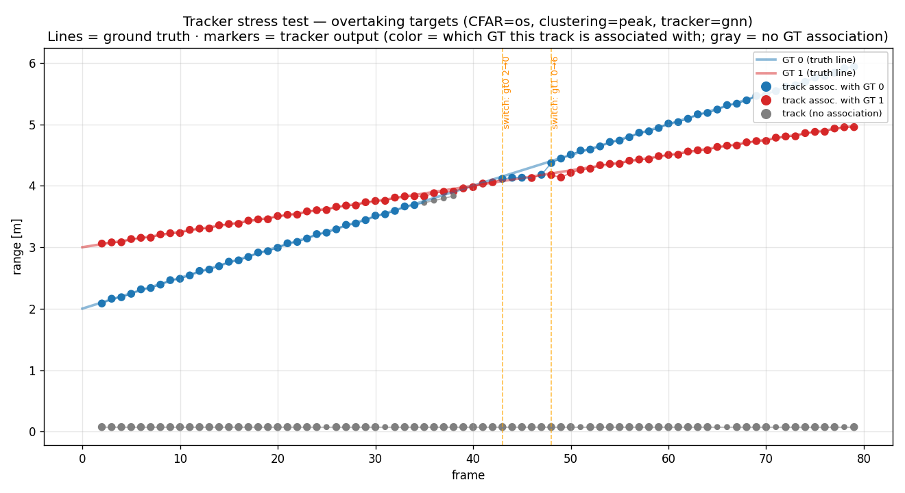
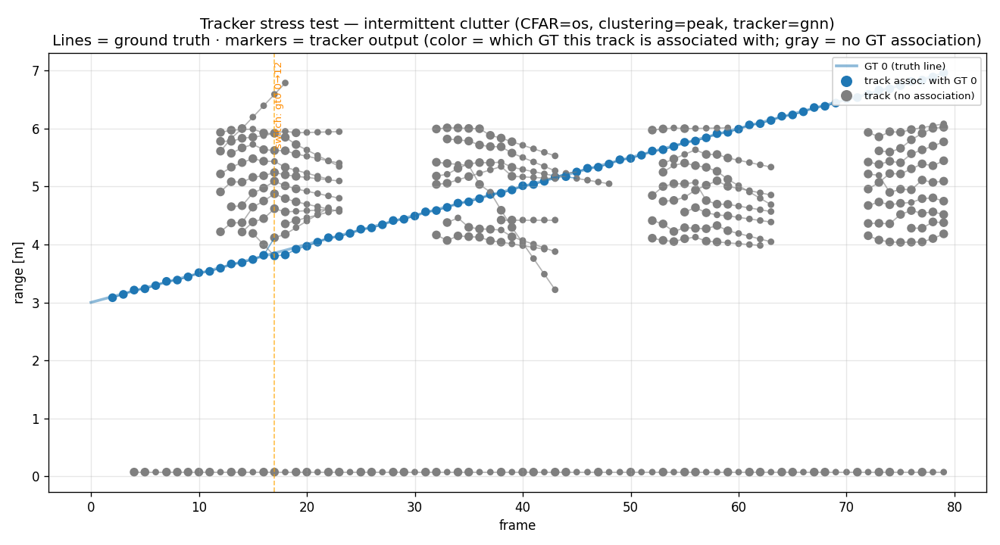
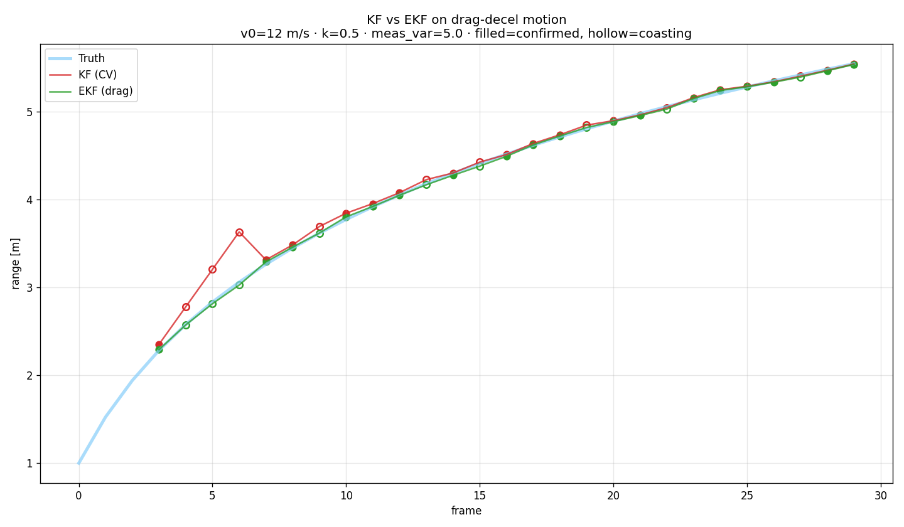
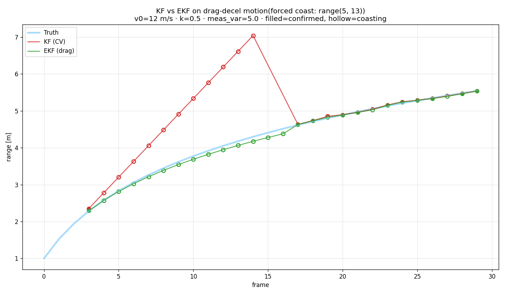
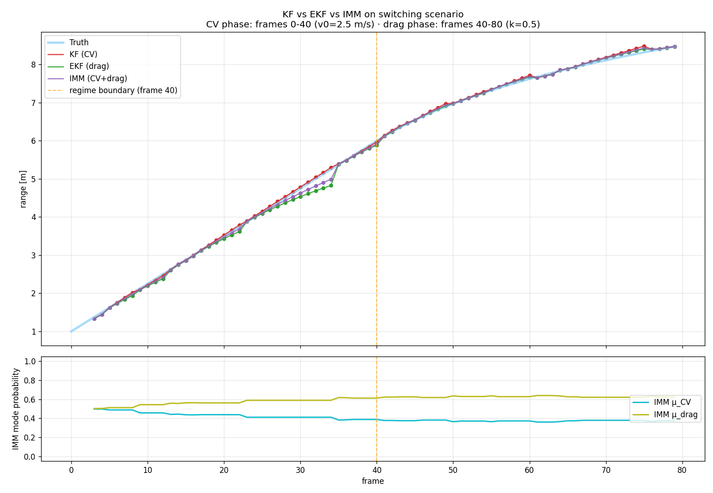
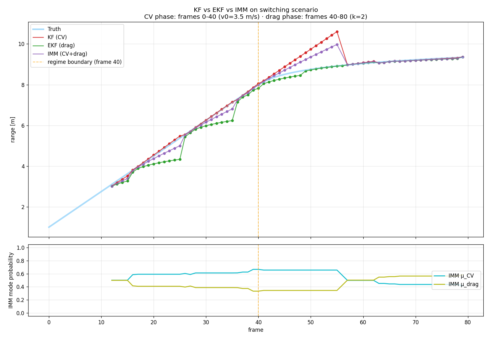

# Tracker Stress Test — Systematic Experiments and Results

**Date:** 2026-06-04
**Branch:** `feat/tracker-stress-test`
**Pipeline under test:** `range_doppler` (Hann window, DC removal) → `cfar_2d`
(OS-CFAR, Pfa = 1e-4) → `cluster` (peak-picking, min_cells = 2) → `Tracker`
(GNN association, M-of-N confirmation, Kalman/EKF/IMM filtering).

---

## 1. Introduction

A radar tracker turns a stream of per-frame detections into persistent target
tracks. Between the detector and the track output sit several pieces of
machinery — data association, gating, M-of-N track confirmation, coasting
through missed detections, and a motion-model filter (Kalman or one of its
nonlinear extensions). Each of these can fail, and each fails in a
characteristic way. The purpose of a *stress test* is to drive the tracker into
those failure modes deliberately, with controlled scenarios, and measure how
gracefully it degrades.

This report characterizes our tracker along two dimensions:

- **Three stress conditions** that attack the tracker's *plumbing* (the
  association / confirmation / coasting logic):
  1. **Missed detections** — a marginal-SNR target that the CFAR detector drops
     on some frames, forcing the tracker to coast.
  2. **Crossing / overtaking targets** — two targets whose tracks must stay
     distinct as they approach in range, stressing data association.
  3. **Intermittent clutter** — periodic clutter bursts that spawn spurious
     detections competing with the true target.

- **Three tracking algorithms** whose differences show up when the target's
  *motion* violates the simple model:
  1. **KF** — linear Kalman filter, constant-velocity (CV) motion model.
  2. **EKF** — extended Kalman filter with a quadratic-drag motion model.
  3. **IMM** — interacting multiple model filter blending a CV and a drag-EKF
     constituent, with adaptive mode probabilities.

The scenarios fall into three conceptual families. *Which algorithm wins* means
something different in each, so the report is organized around them:

| Family | Scenarios | What it stresses | Expected outcome |
|---|---|---|---|
| **A. Detection / association stress** | missed detections, crossing, intermittent clutter | tracker plumbing; motion is ~constant velocity | all three algorithms broadly similar |
| **B. Motion-model mismatch** | drag deceleration | a single nonlinear regime; CV assumption breaks | EKF ≈ IMM > KF |
| **C. Regime switching** | CV→drag mid-track | a mode change the tracker must detect | only IMM tracks both phases |

Family A is the core stress test and receives the full statistical treatment
(Section 3). Families B and C are presented as focused single-scenario case
studies that justify the EKF and IMM filters respectively (Sections 4–5).

### 1.1 Tracker configuration parameters

The tracker's behavior is governed by `TrackerConfig`
(`processing/config.py`). The stress tests in this report vary a few of these
knobs (notably `max_coast`, `process_noise_q`, `confirm_M`/`confirm_N`) and hold
the rest at their defaults. The full parameter set, grouped by role:

**Association & gating** — deciding which detection updates which track:

- **`method`** (`"gnn"`) — data-association strategy: `"nn"` (greedy
  nearest-neighbour, each track grabs its closest detection) or `"gnn"` (global
  nearest-neighbour, one joint assignment minimizing total cost). GNN is more
  robust when tracks compete for the same detection.
- **`gate_threshold`** (`9.21`) — the association gate, expressed as a squared
  Mahalanobis distance. A detection can only update a track if it falls within
  this normalized distance of the track's prediction. The default 9.21 is the
  χ²(2 DOF) value at 99 % confidence — a detection is gated out if it is more
  than a 99th-percentile statistical surprise.

**Kalman / EKF filtering** — turning gated detections into a smoothed state:

- **`process_noise_q`** (`0.5`) — process-noise intensity. How much the filter
  expects the true state to drift between frames; higher values make the filter
  trust new measurements more (responsive but jittery), lower values make it
  lean on its prediction (smooth but laggy).
- **`range_meas_var`** (`0.5`) — assumed measurement-noise variance on the range
  measurement (range-bin units²).
- **`doppler_meas_var`** (`1.0`) — assumed measurement-noise variance on the
  Doppler measurement (Doppler-bin units²).
- **`init_velocity_var`** (`4.0`) — initial variance placed on the velocity
  state when a track is first spawned, encoding how uncertain the birth velocity
  is.
- **`doppler_smoothing_beta`** (`0.5`) — exponential-smoothing factor (0–1]
  applied to a track's Doppler-bin estimate used for association; lower values
  smooth the Doppler more heavily across frames.

**Track lifecycle (confirmation, coasting, deletion)** — the M-of-N logic the
stress tests exercise most:

- **`confirm_M`** (`3`) / **`confirm_N`** (`5`) — the M-of-N confirmation rule: a
  tentative track is promoted to *confirmed* once it has been hit on at least
  `confirm_M` of the last `confirm_N` frames. Stricter values suppress
  clutter-born tracks but slow confirmation of real ones (the §3.3.2 sweep).
- **`max_misses_tentative`** (`2`) — a *tentative* (not-yet-confirmed) track is
  deleted after this many consecutive misses, so spurious detections die quickly.
- **`max_coast`** (`5`) — a *confirmed* track is kept alive, coasting on its
  prediction, for up to this many consecutive misses before deletion. This is
  the parameter that decides whether a track survives a missed-detection gap
  (the §3.1.2 sweep).
- **`history_len`** (`10`) — number of past states retained per track (for
  trajectory output / plotting).

**Motion model** — what the filter assumes about target dynamics:

- **`motion_model`** (`"cv"`) — `"cv"` (constant-velocity, the linear Kalman
  filter / KF) or `"drag"` (quadratic-drag, the EKF). The IMM blends both via a
  separate `IMMConfig`.
- **`drag_coefficient_k`** (`0.5`) — drag coefficient, used only when
  `motion_model == "drag"`.

**Optional Doppler-aware spawn** — both default to `None` (disabled) and are not
varied in this report:

- **`doppler_to_vel_bins_scale`** / **`doppler_bin_center`** — when both are set,
  a new track initializes its velocity from the detection's Doppler bin instead
  of from zero, giving a faster lock-on for moving targets.

---

## 2. Methodology

### 2.1 Fixed pipeline lens

Every experiment in this report uses one fixed front-end so that tracker
behavior — not detector tuning — is the variable of interest:

| Stage | Choice | Rationale |
|---|---|---|
| Range-Doppler | Hann window, DC removal | standard, suppresses spectral leakage and the DC ridge |
| CFAR | OS-CFAR, Pfa = 1e-4 | winner of the earlier masking sweep; robust at clutter edges |
| Clustering | peak-picking, min_cells = 2 | winner of the earlier clutter-edge sweep |
| Tracker | GNN association, default M-of-N (3-of-5) | global-nearest-neighbour; production-realistic default |

Range bin 0 is notched out before clustering to remove residual DC leakage.

### 2.2 Metrics

For each run we associate ground-truth (GT) targets to confirmed tracks frame by
frame with a Hungarian assignment in (range-bin, doppler-bin) space, gated at 3
bins. From the association history we compute, per GT:

- **Pd (track-level)** — fraction of frames in which the GT had a confirmed
  track associated with it. Distinct from detector Pd: a track can hold a GT
  through a CFAR miss by coasting, so track-level Pd ≥ detector Pd.
- **Distinct track IDs** — how many different track IDs ever owned this GT. More
  than one means the track was lost and re-acquired (a break) or stolen (a
  switch).
- **Coast frames** — frames in which a GT-owning track was alive but coasting
  (predicting through a miss rather than updating on a detection).

And per run:

- **ID switches** — counted only when a GT's owning track ID changes to a
  *different* ID that then persists ≥ 2 frames (a persistence filter that
  rejects one-frame Hungarian flip-flops).
- **False confirmed tracks** — confirmed track IDs that *never* associated with
  any GT (i.e. tracks born from clutter). *Added for the clutter analysis; see
  §3.3.*

### 2.3 Classification

Each run is reduced to one categorical verdict from two failure axes —
`has_switches` (any persistent ID switch) and `has_break` (any GT with
Pd < 0.5):

| Class | Condition | Meaning |
|---|---|---|
| **CLEAN** | no switches, no break | every target held with one stable ID |
| **ID SWITCH** | ≥1 switch, no break | targets tracked, but an ID jumped between them |
| **TRACK BREAK** | break, no switch | a target lost for more than half the run |
| **TOTAL CONFUSION** | switch **and** break | lost a target *and* scrambled IDs |

### 2.4 Monte Carlo design (Family A matrix)

The Family-A robustness check (§3.4) runs the **KF** tracker on each scenario over
**30 seeds**. Varying the seed re-draws the measurement noise and the clutter
placement; the GT trajectory is deterministic and unchanged across seeds.
Numeric metrics are reported as mean ± std; the categorical classification is
reported as a rate breakdown (e.g. "24/30 CLEAN"). The seed is overridden per
run via the harness; the canonical seed remains in each scenario JSON for
single-shot reproducibility.

All single-run figures below use that canonical seed (99999).

### 2.5 Two independent RNG streams (seed hygiene)

The pipeline draws random numbers in **two separate places**, and keeping their
seeds independent is what makes the Monte Carlo statistically honest:

| Stream | Seeded by | What it draws | Role |
|---|---|---|---|
| **Signal generator** | `RadarConfig.seed` (per-run, overridden by the matrix) | thermal noise + the clutter field added inside `generate_frame()` | the *data* — the noisy frame the detector must work on |
| **CFAR calibration** | `cfar_2d(seed=…)`, fixed at its default `0` | pure-noise samples used to set the detection threshold for the target Pfa | the *detector tuning* — a fixed property of the front-end |

Crucially, the **target signal itself is deterministic** — it is computed from
each target's range / velocity / amplitude / phase and uses no RNG, so it is
byte-identical at every seed. Only the *noise floor* (thermal + clutter) varies
with `RadarConfig.seed`. That is exactly the Monte Carlo we want: the same truth,
re-exposed under independent noise draws.

**Why the two seeds must differ.** CFAR sets its threshold to achieve the target
false-alarm rate *against its own seed-0 calibration noise*. If the generator's
noise were drawn from the **same** seed, the noise inside the frame would share
that calibration stream — the threshold would be tuned *in-sample* to the very
noise it is then applied to, making the measured Pfa (and hence Pd) optimistic.
The codebase guards against this by defaulting `RadarConfig.seed` to `99999`
(decoupled from CFAR's `0`).

**Consequence for the matrix.** The CFAR seed is left fixed at `0` (so every
run — and every number elsewhere in this report — is calibrated identically),
and the matrix draws its 30 per-run generator seeds from **`1…30`, deliberately
excluding `0`**. Any nonzero seed yields an independent PCG64 stream, so every
matrix run sees out-of-sample noise relative to the detector's calibration.

> *These two are the only RNG streams active in the experiments. Two further
> RNG sites exist in the codebase but are inert here: the GO/SO CFAR
> calibration (`_goso_alpha`) is never reached on the OS-CFAR path this report
> uses, and the generator's `__main__` demo config is never constructed when
> scenarios are loaded from JSON. Everything else — `range_doppler`,
> clustering, and the tracker (GNN association, Kalman/IMM filtering, integer
> track IDs) — is fully deterministic.*

---

## 3. Family A Case Study — Detection / Association Stress

**Every run in this section uses the KF tracker — the linear Kalman filter with
the constant-velocity (CV) motion model.** Family-A motion is ~constant
velocity, so this is the matched filter; the EKF and IMM are reserved for the
nonlinear-motion case studies in §4–5 (where they actually differ from KF — see
§3.4).

The section is structured **qualitative-then-quantitative**: each stressor first
gets an intuitive single-run illustration (fixed seed), and the multi-seed KF
robustness summary is consolidated at the end (§3.4).

### 3.1 Missed detections

This scenario stresses **track continuity**: a single target intermittently
drops below the CFAR threshold, so the detection stream has gaps. The tracker
must bridge those gaps by coasting on its motion model rather than deleting the
track and re-spawning a fresh ID — the lever that decides between the two is
`max_coast`. A second knob, `process_noise_q`, does not affect survival but sets
the *quality* of the coasted estimate: how far the predicted position is allowed
to drift while no detection is updating it.

#### 3.1.1 Illustrative run

**Scenario** (`scenario_missed_detections.json`): A single target at ~4 m moving at 0.5 m/s, with amplitude tuned to
sit near the CFAR threshold so random noise drops it below detection on a
substantial fraction of frames. The tracker must bridge those misses by
coasting.

CMD: `python -m evaluation.tracker_stress --scenario scenarios/scenario_missed_detections.json --algorithm kf`

With the default tracker (max_coast = 5), the single GT is held continuously as
one track ID across the whole run. The Pd reported here is the track-level Pd —
`n_assoc_frames / total_frames`, with `total = 80` frames (computed in
`evaluate_run`, `tracker_stress.py`).

| Metric | Value |
|---|---|
| Track-level Pd | **0.61** |
| Distinct track IDs | 1 |
| Coast frames | 28 |
| ID switches | 0 |
| **Classification** | **✓ CLEAN** |

The plot tells the story: the blue (associated) and gray (alive-but-unassociated
/ coasting) markers both ride the truth line tightly. Roughly 40 % of frames are
misses (track-level Pd 0.61), yet the tracker never drops the target — it simply
coasts through each gap on the Kalman prediction and re-acquires the *same* track
ID when the detection returns. This is the success mode: a marginal target,
absorbed.

**The failure mode is one parameter away.** A weaker target
(`scenario_missed_detections_weak.json`: *identical* to the run above — same 4 m
range, same 0.5 m/s velocity, so it stays well within the ~9.5 m unambiguous
range the whole run — with **only the amplitude lowered**, 0.0006 → 0.0005)
drops below the CFAR threshold often enough that the tracker can no longer bridge
the gaps. The result is a clear in-range collapse: the target is
confirmed-associated on only **38 % of frames**, and the tracker churns through
**3 distinct track IDs** — its identity switching twice, at **frame 40** (track
0 → 3) and **frame 69** (track 3 → 5) — as the track repeatedly dies and
respawns. The full metrics:

CMD: `python -m evaluation.tracker_stress --scenario scenarios/scenario_missed_detections_weak.json --algorithm kf`

| Metric | Value |
|---|---|
| Track-level Pd | **0.38** |
| Distinct track IDs | 3 |
| Coast frames | 37 |
| ID switches | 2 (frame 40: 0→3; frame 69: 3→5) |
| **Classification** | **⚠ TOTAL CONFUSION** |

The figure confirms the mechanism is genuine *missed detections*, not loss of the
target: the markers ride the truth line across the whole run — the target is
always physically observable — but they are mostly gray (coasting /
unassociated), the track fragments into 3 distinct IDs, and the identity switches
twice. With SNR as the only changed parameter, the tracker goes from holding the
target as one clean ID (Pd 0.61, CLEAN) to losing the association on ~60 % of
frames and scrambling IDs.

Two honest caveats on this contrast:

- **The dominant in-range failure is TOTAL CONFUSION, not a pure TRACK BREAK.**
  At marginal SNR the track does not simply vanish; it dies *and* respawns with
  new IDs, so the churn adds switches on top of the break. A clean
  break-without-switches is actually the rarer outcome here.
- **It is robust, not a single-seed artifact.** Across 12 seeds at this
  amplitude, **12/12 runs fail** (10 TOTAL CONFUSION, 2 TRACK BREAK), mean
  Pd 0.31 ± 0.09. The canonical-seed figure above (Pd 0.38) is a representative
  member of that distribution, not a cherry-pick.

| Variant (only amplitude differs) | Pd | Distinct IDs | Classification |
|---|---|---|---|
| missed_detections (amp 0.0006) | 0.61 | 1 | ✓ CLEAN |
| missed_detections_weak (amp 0.0005) | 0.38 | 3 | **⚠ TOTAL CONFUSION** |

#### 3.1.2 Hyperparameter sweeps

The two tracker knobs most relevant to coasting — `max_coast` and
`process_noise_q` — act on **orthogonal** parts of the tracker, so they are
characterized by two separate 1-D sweeps, each paired with the metric its knob
actually moves. (`max_coast` decides *whether a track survives a gap*, a
discrete association outcome; `process_noise_q` decides *how good the estimate
is*, a continuous quantity. A single 2-D `max_coast × q` grid would waste its q
dimension — q cannot move the discrete metrics at all, as the second sweep
shows.)

**max_coast sweep** (`tracker_stress_maxcoast_sweep.py`) — discrete survival
metrics:

CMD: `python -m evaluation.tracker_stress_maxcoast_sweep`

| max_coast | Pd | distinct | coast | Classification |
|---|---|---|---|---|
| 1 | 0.46 | 7 | 12 | TOTAL CONFUSION |
| 2 | 0.46 | 7 | 12 | TOTAL CONFUSION |
| 3 | 0.56 | 3 | 21 | ID SWITCH |
| 5 | 0.61 | 1 | 28 | ✓ CLEAN |

**`max_coast` is the survival lever, monotonically.** Tightening it from 5 to 1
walks the run straight down the failure ladder: CLEAN → ID SWITCH → TOTAL
CONFUSION. With max_coast = 1–2 the track is killed after a single miss, so it
dies and respawns repeatedly (7 distinct IDs, Pd 0.46); at max_coast = 5 it
survives every gap as one ID. In a missed-detection regime, coast tolerance
*is* the survival parameter.

**process_noise_q sweep** (`tracker_stress_q_sweep.py`) — continuous
track-position RMSE, with `n_assoc` (frames with an associated track) as a
control column:

CMD: `python -m evaluation.tracker_stress_q_sweep`

| q | track-position RMSE (cm) | n_assoc |
|---|---|---|
| 0.05 | 1.80 | 49 |
| 0.1 | 1.89 | 49 |
| 0.3 | 2.01 | 49 |
| 1.0 | 2.12 | 49 |
| 3.0 | 2.23 | 49 |
| 10.0 | 2.34 | 49 |

Two findings:

1. **q is perfectly inert on association.** `n_assoc` is constant at 49 across a
   200× range of q. The misses here are detection-*absent* (the marginal target
   produced no detection that frame — q cannot conjure one), re-detections are
   near-coincident with the prediction (in-gate at any q), the coasted
   constant-velocity *mean* is q-independent (q inflates only the covariance),
   and track deletion is governed by `max_coast`. So q cannot move Pd, distinct
   IDs, or the classification — which is why it does *not* appear as an axis of
   the max_coast sweep above.
2. **q does move the estimate quality**, monotonically: RMSE rises 1.80 → 2.34
   cm as q increases. This is the smoothing-vs-responsiveness tradeoff — a
   higher q raises the Kalman gain, so the estimate chases measurement noise
   instead of trusting the (here, excellent) constant-velocity prediction. The
   sign is scenario-specific: because this slow target is CV-matched, **lower q
   wins**; under model mismatch or maneuvering it would flip. (A 6-seed check
   confirms the q-driven spread exceeds seed-to-seed noise, so the trend is
   signal, not luck.)

The pair illustrates a clean separation of concerns: **`max_coast` acts on
track survival (discrete), `process_noise_q` acts on estimate quality
(continuous), and neither touches the other's metric.**

### 3.2 Crossing and overtaking targets

These scenarios stress **data association**: two targets approach in range and
the tracker must keep their IDs straight. The two variants differ in Doppler
separation, which turns out to be decisive.

#### 3.2.1 Crossing (opposite-direction) — CLEAN

**Scenario.** Two high-SNR targets, one at 2 m moving out at +1 m/s, one at 6 m
moving in at −1 m/s. They meet at 4 m around frame 40. Their velocities are
equal and opposite, so they stay ~3 Doppler bins apart throughout — the crossing
is in *range only*.

CMD: `python -m evaluation.tracker_stress --scenario scenarios/scenario_crossing_targets.json --algorithm kf`

| GT | Pd | Distinct IDs |
|---|---|---|
| GT 0 | 0.97 | 1 |
| GT 1 | 0.97 | 1 |
| ID switches | 0 | |
| **Classification** | **✓ CLEAN** | |

Each track keeps its color (its GT association) cleanly across the crossing. The
opposite-sign Doppler is what saves it: even though the two targets occupy the
same range bin at frame 40, they are well separated in the Doppler dimension, so
the GNN association never confuses them. Range-only crossing, with Doppler
separation, is **not** a hard case for this tracker.

#### 3.2.2 Overtaking (same-direction) — ID SWITCH

**Scenario.** Two targets moving the *same* direction at different speeds, so the
faster one overtakes the slower around frames 43–48. Because they move together,
their Doppler bins converge at the overtake — there is no separating dimension.

CMD: `python -m evaluation.tracker_stress --scenario scenarios/scenario_overtaking_targets.json --algorithm kf`

| GT | Pd | Distinct IDs |
|---|---|---|
| GT 0 | 0.86 | 2 |
| GT 1 | 0.93 | 2 |
| ID switches | **2** (frame 43: gt0 2→0; frame 48: gt1 0→6) | |
| **Classification** | **⚠ ID SWITCH** | |

Now the tracker fails exactly where the crossing succeeded. At the overtake, the
two targets are close in *both* range and Doppler, the gates overlap, and GNN
swaps the assignments: GT 0's track ID jumps 2→0 at frame 43 and GT 1's jumps
0→6 at frame 48 (two annotated switch events on the plot). Both GTs end up with
2 distinct IDs. This identity swap is *structural* — it follows from the two
targets losing every separating dimension at the overtake, not from a particular
noise draw (seed-robustness quantified in §3.4).

**The contrast is the point.** Crossing vs. overtaking isolate the role of the
Doppler dimension in association: a crossing that looks visually dramatic
(targets meeting head-on) is trivial when Doppler separates them, while an
overtake that looks gentle is genuinely hard because no dimension separates the
targets at closest approach.

### 3.3 Intermittent clutter

This scenario stresses **false-track rejection**: bursts of clutter spawn
spurious detections competing with the true target, and the tracker must avoid
promoting those clutter-born detections into confirmed tracks while still
holding the real one. The knob that governs how readily a tentative track is
promoted is the M-of-N confirmation rule (`confirm_M` hits of the last
`confirm_N` frames) — the lever swept in §3.3.2.

#### 3.3.1 Illustrative run

**Scenario** (`scenario_intermittent_clutter.json`): A single high-SNR target crossing 3 → 6.4 m, while a clutter band
(CNR 30 dB, 4–6 m) switches on for four ~10-frame windows (frames 10–20, 30–40,
50–60, 70–80). When on, the clutter spawns spurious detections in the same range
region the target passes through.

CMD: `python -m evaluation.tracker_stress --scenario scenarios/scenario_intermittent_clutter.json --algorithm kf`

| Metric | Value |
|---|---|
| Track-level Pd (true target) | 0.97 |
| Distinct track IDs (true target) | 3 |
| Coast frames | 15 |
| ID switches | 1 (frame 17: track 0 → 12) |
| **Classification** | **⚠ ID SWITCH** |

The plot is striking: during each ON window a dense cloud of **gray
false-track markers** erupts in the 4–6 m band, while the true blue track
threads through it. The true target survives (Pd 0.97), but it is not untouched
— it picks up 3 distinct IDs over the run and suffers one ID switch at frame 17,
inside the first clutter burst, where a clutter-born track briefly steals the
association.

The clutter load is large: this run spawns **35 distinct false confirmed tracks,
up to 9 alive simultaneously** — confirmed track IDs that *never* associate with
the GT (`count_false_confirmed_tracks`, the same association-based metric used in
§3.3.2 and §3.4). The clutter band is strong and persistent enough (fixed
range/Doppler band, 30 dB CNR, present every frame of each ON window) that many
of these spurious detections survive M-of-N confirmation; §3.4 shows the count
holds at 35 ± 3 across 30 seeds. This sets up the sweep in §3.3.2.

#### 3.3.2 Hyperparameter sweep — `confirm_M`-of-`confirm_N`

Does tightening the M-of-N confirmation rule suppress the clutter-born tracks?
This sweep tightens the rule along the "M of N = 5" axis — from a loose 2-of-5
up to the strict 5-of-5 (`M = N`) corner — and reports the suppression benefit
and the cost to the true target **jointly**: In the table, `false tracks` is the number of distinct
clutter-born confirmed tracks (tracks confirmed but never associated with the
GT), `max simultaneous` is the peak alive simultaneously, and Pd / distinct / class
describe the single true target.

CMD: `python -m evaluation.tracker_stress_confirm_mn_sweep`

| rule (M-of-N) | false tracks | max simultaneous | true Pd | true distinct IDs | Classification |
|---|---|---|---|---|---|
| 2-of-5 | 35 | 9 | 0.99 | 3 | ⚠ ID SWITCH |
| 3-of-5 (default) | 35 | 9 | 0.97 | 3 | ⚠ ID SWITCH |
| 4-of-5 | 35 | 9 | 0.96 | 3 | ⚠ ID SWITCH |
| 5-of-5 (`M = N`) | 24 | 8 | 0.95 | 2 | ⚠ ID SWITCH |

**Confirmation depth is a weak defense against a persistent high-CNR clutter
band.** Raising M from 2 to 4 (at N = 5) does **nothing** to the false-track load — it stays
pinned at 35 distinct false tracks, 9 alive at once. The clutter band is on for
~10-frame windows, which is long enough for a spurious detection to rack up 4
hits in 5 frames just as easily as 2, so a stricter "M of 5" rule filters none
of them out. Only the extreme 5-of-5 corner — demanding a hit on *every* one of
the last five frames — finally bites, and even then it removes barely a third of
the false tracks (35 → 24). That corner is also the one that **starts to starve
the true target**: its Pd slips 0.97 → 0.95 and it loses a distinct ID (3 → 2),
because the same all-or-nothing rule punishes the real target's own occasional
misses. And across the entire sweep the classification never improves: the
frame-17 ID switch from §3.3.1 survives every setting, because confirmation
depth does nothing about a clutter track that is *already* confirmed when it
steals the association.

The conclusion is the same one the pilot anticipated, now measured: **for a
persistent, high-CNR clutter band, M-of-N confirmation is the wrong lever.** The
false-track load is *birth-driven* — each clutter track is spawned from a
detection the tracker never assigned to an existing one (`tracking.py`, "spawn
from unassigned detections"), so the count is governed by how many clutter
detections arrive, not by how cautiously they are promoted. The effective
defense therefore lives **upstream of the tracker, at the detector stage** —
raising the CFAR detection threshold (lower Pfa) or improving CNR margin, so the
band clears fewer detections in the first place.

The more familiar detector-stage defense, **clutter-map / MTI removal, would
*not* help here**, and it is worth being precise about why. A clutter map
suppresses clutter by estimating its *stationary* signature — the part that
repeats frame to frame — and subtracting it before detection. This scenario's
clutter has no such signature: it is a band-limited Gaussian field **redrawn
independently every frame** (`_generate_clutter_beat_signal` draws fresh noise
from the generator's RNG, which `generate_frame` never reseeds). It is coherent
*within* a frame — band-limited in Doppler, so it integrates into concentrated
30 dB-CNR detections rather than washing out like thermal noise — but *across*
frames it is zero-mean and uncorrelated, so its time-average is ≈ 0 and a static
clutter map has nothing to subtract. Clutter maps earn their keep against fixed
physical scatterers (ground, buildings); a frame-independent noise band is
exactly the case they cannot touch. That leaves the detection threshold and CNR
margin as the only effective upstream levers — both outside this report's fixed
front-end (§2.1), so noted as the expected fix rather than measured here.

Crucially, neither *tracker-level* knob helps either: confirmation depth is flat
(above), and tightening the association gate is if anything *adverse* — a
tighter gate leaves more clutter detections unassigned, which spawns *more*
tentative tracks, not fewer.

### 3.4 Statistical robustness across seeds

The single-run illustrations in §3.1–3.3 each used one fixed seed. This
subsection establishes that they are **representative**, not lucky draws, by
running the **KF** tracker on all four Family-A scenarios over **30 seeds**
(`1…30`, see §2.5) and reporting the distribution of each metric.

> *Why KF only, and not a KF/EKF/IMM comparison.* Family-A motion is ~constant
> velocity, which is the one regime the three filters do **not** meaningfully
> differ on — the drag-EKF and the IMM's drag mode have no model mismatch to
> correct, so they collapse onto the CV filter and produce the same track
> associations. Any residual difference would live in the continuous estimate,
> well below what the discrete metrics reported here can resolve, so we did not run
> the comparison: Family A cannot meaningfully *compare* the filters. The genuine
> filter comparison, where the motion violates CV and the estimates diverge by
> metres, is the subject of the Family-B and Family-C case studies (§4–5). This
> section is a robustness check on the tracker, not a filter contest.

CMD: `python -m evaluation.tracker_stress_matrix`

The output is two CSVs: `tracker_stress_matrix_raw.csv` — 180 rows,
one per (scenario, seed, GT), the auditable per-run source of truth, and
`tracker_stress_matrix_summary.csv` — the 4-row per-scenario aggregate that the
table below is transcribed from, over the
30 seeds — one row per scenario — with the classification-rate breakdown:

| Scenario | Pd | distinct | coast | switches | false confirmed tracks | Classification (over 30) |
|---|---|---|---|---|---|---|
| missed_detections | 0.67±0.05 | 1.10±0.30 | 22.9±4.1 | 0.10±0.30 | 0.0±0.0 | 27 CLEAN, 3 ID SWITCH |
| crossing_targets | 0.97±0.00 | 1.00±0.00 | 0.0±0.0 | 0.00±0.00 | 3.0±0.9 | 30 CLEAN |
| overtaking_targets | 0.89±0.03 | 2.00±1.00 | 2.1±2.2 | 2.00±0.00 | 1.0±0.0 | 30 ID SWITCH |
| intermittent_clutter | 0.97±0.00 | 3.80±2.02 | 21.2±14.5 | 1.37±1.52 | 35.0±2.7 | 12 CLEAN, 18 ID SWITCH |

**The single-run figures are representative.** Each seed distribution brackets
the KF value cited earlier: `missed_detections` 0.67±0.05 contains the §3.1.1
figure of 0.61 (one draw at the canonical seed 99999); `crossing` and `clutter`
sit at 0.97 as in §3.2.1/§3.3.1; and `overtaking` brackets the §3.2.2 run (per-GT
Pd 0.86/0.93, two ID switches) at Pd 0.89±0.03 with exactly two switches on every
seed. So the illustrative runs were typical, not cherry-picked.

**What the spread says about each stressor.**
- `crossing_targets` is the most **stable** — every seed is CLEAN, Pd 0.97 with
  zero variance. Doppler-separated association is robust to noise.
- `overtaking_targets` is its **deterministic mirror image**: **30/30 ID SWITCH**,
  every seed with exactly two switch events (switches 2.00±0.00) and no break (Pd
  0.89±0.03, targets never lost). When the two targets share both range and
  Doppler at the overtake there is no separating dimension, so the identity swap is
  structural — noise never rescues it and never worsens it into a break. This
  confirms the §3.2.2 single-run result is the rule, not a lucky draw.
- `missed_detections` is **tight in Pd but occasionally fragile**: Pd 0.67±0.05,
  CLEAN on 27/30 seeds, with 3 seeds tipping into a single ID switch as the
  marginal target's miss pattern happens to fragment the track.
- `intermittent_clutter` is the most **variable**: Pd is rock-steady (0.97) but
  the discrete metrics scatter widely (distinct 3.80±2.02, coast 21.2±14.5,
  switches 1.37±1.52), and only 12/30 seeds stay CLEAN. The clutter realisation
  drives large run-to-run variation in how many false tracks compete and whether
  one transiently steals the association — exactly the behaviour §3.3 anticipated,
  now quantified across seeds.

---

## 4. Family B Case Study — Motion-Model Mismatch (drag deceleration)

This case study compares EKF and KF under a non-linear motion model. First, choose a 1-D non-linear motion model and build a scenario, then compare the tracking performance of KF and EKF under that scenario.

### 4.1 Scenario with 1-D nonlinear motion model

There are multiple choices of 1-D nonlinear motion models: quadratic drag, sinusoidal/periodic motion, stop-and-go/sticky motion, ballistic with drag, etc. Here we choose the simplest, quadratic drag, for demonstration.

**Scenario** (`scenario_drag_decel.json`): a single target starting at 1 m and
**12 m/s**, decelerating under **quadratic drag** (`drag_coefficient_k = 0.5`):
velocity follows `v(t) = v₀ / (1 + k·v₀·t) = 12 / (1 + 6t)`, slowing from 12 m/s
to ~1.2 m/s over the plotted 1.5 s (30 frames) while the range climbs from 1 m to
~5.6 m. The high initial velocity is deliberate — the per-frame KF-vs-EKF model
mismatch scales as `k·v²`, so starting fast makes the CV-vs-drag difference as
pronounced as possible. The amplitude sits near the CFAR threshold so that on
missed frames the tracker must coast on its motion model alone — and that coast
is the *only* place the CV-vs-drag choice can show, since both filters use the
same detections when detections exist.

### 4.2 KF vs EKF
KF assumes constant velocity; EKF assumes the drag law — they differ only in what
they predict during a coast. To make that predict step carry more weight, the
tracker's `range_meas_var` is raised to 5.0, lowering the Kalman gain so the
filter leans on its prediction (where KF/EKF differ) instead of the measurement. Run through
the standard pipeline:

CMD: `python -m evaluation.compare_kf_ekf_drag_decel` (run from the repo root)

The plot shows the coasts diverge only modestly. The effect is real but undramatic. In the natural CFAR-miss coast streak (hollow
markers, frames ~4–6) the KF (red) overshoots truth by ~0.4 m, while the
EKF (drag, green) stays on the truth curve. But the streak is only ~3 frames
long, so the KF snaps back the moment a detection arrives (frame 7), and across
the full run the two filters are nearly indistinguishable. The limiting factor is
coast *length*: natural coasts here are too short for the CV prediction to run away,
and scenario tuning alone cannot reliably manufacture a long one. (Doppler-aware
spawn is enabled here, so the track locks on early enough to catch
the high-velocity, high-mismatch phase — without it the divergence is smaller
still.)

To demonstrate it, we force a long coast to isolate and magnify the difference: a fixed coast window is imposed, detections are discarded on frames 5–12, so both filters run purely on prediction over a long stretch.

CMD: `python -m evaluation.compare_kf_ekf_drag_decel --forced_coast` (run from the repo root)

Now the divergence is unmistakable. Through the forced coast:

- **KF (CV, red)** extrapolates at *constant velocity* and overshoots badly —
  climbing to ~7 m while truth is at ~4.5 m — then snaps back violently when
  detections resume around frame 17. A CV filter coasting through a deceleration
  cannot help but overshoot.
- **EKF (drag, green)** extrapolates along the *drag curve* and tracks truth
  closely (a touch low) for the entire window, because its motion model matches
  the physics generating the trajectory.

**Conclusion.** The model difference is genuine but only bites under *sustained*
coasting through nonlinear motion: with the short natural coasts, the two
filters are nearly interchangeable; force a long coast and the CV assumption
diverges by metres. This is the canonical justification for the EKF — when the
motion is nonlinear and detections are sparse, the motion model *is* the
estimate, and a wrong model fails exactly as the red curve shows.

---

## 5. Family C Case Study — Regime Switching (CV → drag)

This case study pushes the scenario a bit further. Family B handles a *single* nonlinear regime, where a fixed drag-EKF wins. But if the target's dynamics *change* partway through the run, no single fixed model
is correct end to end: a CV filter is right early and wrong late, a drag filter
is wrong early and right late. The motion is **piecewise** — a sequence of
distinct regimes — and that is precisely the condition the IMM exists for. This case study adds the IMM to the comparison besides KF and EKF.

### 5.1 The IMM filter and the piecewise motion model

The **IMM (Interacting Multiple Model)** filter answers this by running a *bank*
of constituent filters in parallel rather than committing to one motion model. It
maintains a mode-probability vector saying how much to trust each constituent,
updates those probabilities each frame from how well each model predicted the
latest measurement, and reports the probability-weighted blend of their states. A
Markov transition matrix governs how readily the mixture migrates from one mode
to another. The configuration used here (`IMMConfig`):

- **`models`** — two constituents: a **CV-KF** (linear Kalman filter) and a
  **drag-EKF** whose drag coefficient is matched to the scenario's drag-phase `k`, the same two fixed
  models as §4.
  The generating script reads `k` straight from the scenario, so the filter is
  always matched to the target.
- **`transition_matrix`** = `[[0.95, 0.05], [0.05, 0.95]]` — *sticky*: in each
  frame, a mode has a 95 % chance of persisting and a 5 % chance of switching, so the
  mixture commits to the currently-supported model but can still migrate when the
  evidence shifts.
- **`initial_mode_probs`** = `[0.5, 0.5]` — no prior preference between CV and
  drag at track birth.
- Shared filter settings match §4: `range_meas_var = 5.0` (low Kalman gain so the
  predict step — where the models differ — carries weight) and `max_coast = 15`.

The IMM only earns its keep under a regime *change*: on a single-regime nonlinear
motion (Family B) a plain EKF already suffices, and on constant-velocity motion
(Family A) all three filters collapse to the same answer. So to exercise it we
need a target whose ground-truth motion is itself piecewise.

### 5.2 Scenario I

**Scenario** (`scenario_imm_switching.json`): a single target starting at 1 m and
**2.5 m/s** whose motion model is **`piecewise`** with two phases:

- **Frames 0–40 — constant velocity.** The target cruises at 2.5 m/s, so the
  range climbs linearly from 1 m to ~6 m.
- **Frames 40–80 — drag** (`drag_coefficient_k = 0.5`). At the boundary the
  target begins decelerating: `v(t) = 2.5 / (1 + 1.25t)` and
  `r(t) = 6 + 2·ln(1 + 1.25t)` (t measured from frame 40), reaching ~8.5 m by
  frame 79. The amplitude sits near the CFAR threshold, so the target is dropped
  on some frames and the tracker coasts on its motion model — the only place the
  CV/drag/IMM choice can show.

CMD: `python -m evaluation.compare_imm_switching --scenario scenarios/scenario_imm_switching.json` (run from the repo root)

*(The orange line marks the frame-40 regime boundary.)*

The result is underwhelming — all three filters track the
truth tightly through both phases; in the natural coast streaks (e.g. frames
~22–35) the EKF dips at most ~0.5 m below truth before snapping back, and the KF
shows no drag-phase overshoot worth the name. The lower panel is the tell:
**μ_drag sits mildly dominant (~0.6) the entire run — *including the CV phase* —
and there is no crisp switch at frame 40.** On a regime change this gentle, the
IMM has almost nothing to do: a fixed CV or drag filter would serve about as well,
so the experiment does not yet justify the IMM's extra machinery.

### 5.3 Scenario II — making the regime change bite

To expose the IMM's advantage we sharpen the *model mismatch*, which per frame
scales as **`k·v²`**. Two levers raise it (`scenario_imm_switching_v2.json`):
the initial velocity **v₀ 2.5 → 3.5 m/s** and the drag coefficient **k 0.5 → 2.0**.
Everything else — range, amplitude, seed, transition frame, frame count — is held
identical to scenario I, so the change in behavior is attributable to
`k·v²` alone. The peak per-frame mismatch grows from ~`0.5·2.5² ≈ 3.1` to
~`2.0·3.5² ≈ 24.5`, roughly **8×**.

In the drag phase the target now decelerates as `v(t) = 3.5 / (1 + 7t)`,
`r(t) = 8 + 0.5·ln(1 + 7t)`, reaching ~9.34 m by frame 79 (still inside the
unambiguous range).

CMD: `python -m evaluation.compare_imm_switching  --scenario scenarios/scenario_imm_switching_v2.json` (run from the repo root)

Now the divergence is unmistakable:

- **KF (CV, red)** tracks the CV phase well — its model is correct there — but in
  the drag phase it overshoots badly, climbing to ~10.6 m while truth is at
  ~8.5 m, before snapping back when detections resume. The same
  CV-coasting-through-deceleration failure as Family B.
- **EKF (drag, green)** is the mirror image: it *undershoots* and lags during the
  CV phase (its drag model bleeds off velocity the target isn't actually losing),
  then tracks the drag phase well.
- **IMM (purple)** tracks **both** phases — overshooting only to ~10 m in the drag
  phase, between the two fixed filters, because it blends them and re-weights as
  the evidence shifts.

The lower panel shows the mechanism, now with a clear signal: μ_CV (cyan) is the
larger weight (~0.6) through the CV phase, then after the regime boundary the
weight migrates to μ_drag (olive, ~0.6) in the drag phase. The switch lags the
true boundary by a few frames — the filter needs evidence to re-weight — but it
does adapt, which is precisely what neither fixed-model filter can do.

**Why scenario I was flat.** The IMM only earns its keep once coasting
through the *wrong* model produces metres of error, and that error is set by
`k·v²`. The gentle deceleration in scenario I (small `k·v²`) never pulls the CV
prediction far from truth, so the IMM has nothing to switch *for*; only the
amplified `k·v²` makes the mismatch — and the IMM's adaptive re-weighting — visible.
(Amplitude is not the lever: it controls how often the tracker coasts, not the
per-coast divergence. Indeed scenarios I and II share the *same* amplitude
(0.00045) — only `v₀` and `k` differ — yet only scenario II diverges, so the
change cannot be an amplitude effect.) The
divergence here is intrinsic to the scenario, not an artifact of forcing; the
script can still impose a fixed coast window via `--forced_coast`, but it yields a
nearly identical plot.

Together, B and C make the case for the filter hierarchy: EKF beats KF when the
motion is a *single* nonlinear regime; IMM is needed when the regime *changes*
mid-track — and sharply enough that `k·v²` is large.

---

## 6. Cross-Cutting Discussion

*(Cross-cutting synthesis across the experiments of §3–§5.)*

**When does tracker tuning matter most?** The two §3.1.2 sweeps show that
`max_coast` and `process_noise_q` act on orthogonal sub-systems: *coast
tolerance* (`max_coast`) is the parameter that moves a run between CLEAN and
TOTAL CONFUSION (track survival), while `process_noise_q` is inert on those
discrete outcomes and instead trades estimate smoothness for responsiveness
(track RMSE). For the survival question that defines the missed-detection
failure modes, tuning effort belongs on the lifecycle parameters, not the
process-noise covariance.

**When does association fail?** Not when targets look like they cross, but when
they lose *every* separating dimension at once (§3.2, overtaking vs. crossing).
A tracker operating on (range, Doppler) is robust to crossings that preserve
Doppler separation and fragile to overtakes that don't.

**When is filter choice the lever?** Only when the *motion* violates the
constant-velocity assumption — which is exactly what Families B and C stress, and
where the EKF/IMM diverge from KF by metres (§4–5). Family A's motion is
~constant velocity by design, so the drag-EKF and the IMM's drag mode have no
model mismatch to correct: there is no mechanism by which they could separate from
the CV filter on the discrete tracking outcomes (Pd, classification, distinct
tracks) that define Family A's failure modes. We therefore did **not** run a
filter comparison in Family A at all — it would be unable to tell the filters
apart — which is why §3 uses the KF throughout and §3.4 reports the KF's
robustness across seeds rather than a filter contest. Filter choice is examined
only where it can matter: the motion-model case studies of §4–5. The boundary this
report locates: filter choice is immaterial under detection/association stress and
decisive under motion-model stress.

---

## 7. Limitations and Future Work

- **Single radar configuration.** All scenarios share one radar front-end (77
  GHz, 2 GHz bandwidth, 256×64). Behavior at other range/Doppler resolutions is
  untested.
- **Bin-space association.** GT-track association and the gate are defined in
  (range-bin, doppler-bin) units; a metric-space association might score
  borderline cases differently.
- **Confirm sweep (§3.3.2) is KF / single-seed.** Like the missed sweep, it
  characterizes a parameter trend on one algorithm, not across the filter family.
- **Families B and C are single-seed case studies.** The amplified-divergence
  demos illustrate the mechanism clearly but do not establish a statistical
  margin. Multi-seed Monte Carlo for B and C is deferred.
- **Matched (oracle) drag model.** In §4 and §5 the EKF and the IMM's drag
  constituent are handed the target's *true* drag coefficient — §4 via a hand-set
  `K_METRIC`, §5 by reading `drag_coefficient_k` straight from the scenario (then
  converting metric → bin units with `drag_k_metric_to_bins`). A real tracker does
  not know the target's dynamics, so these are **best-case, matched-model**
  results: a mismatch between assumed and true `k` would erode the EKF's gain, and
  a badly wrong `k` could make it worse than the CV-KF. The IMM is the partial
  exception — it can down-weight a poorly-fitting drag mode toward CV — but this
  demo never tests that, since its drag mode is exact. The assumption is a stand-in
  for an estimator that FMCW makes feasible: because the radar measures radial
  velocity each frame and `1/v(t) = 1/v₀ + k·t` is linear in time, `k` is
  recoverable as the slope of `1/v` vs. time over the drag phase (range gives a
  second, independent constraint). A sensitivity sweep (assumed vs. true `k`), an
  online `k`-fit, or a multi-`k` IMM bank would replace the oracle and quantify the
  realistic gap; all are deferred.
- **Truth-aided track selection (§4–§5 plots).** The tracker itself runs in full —
  GNN association, gating, M-of-N confirmation, coasting, birth/death all happen
  normally. The oracle is only in the *plotting*: among the tracker's
  confirmed/coasting output tracks, the overlay scripts draw, each frame, the one
  whose range is *closest to ground truth*, and skip the frame if even that one is
  more than 3 m off. So any false or duplicate tracks the tracker produced still
  exist — they are simply not displayed; the overlay does not *prevent*
  association/false-track failures, it just doesn't *show* them. The motion-model
  conclusions (KF overshoots, EKF/IMM track the drag) are unaffected — they concern
  the filter's estimate, not which track is picked — but the visual cleanliness of
  the B/C overlays should not be read as track-management performance. (It also
  matters little here because the B/C scenarios are single-target with negligible
  clutter, so association is barely stressed.) An identity-based selection (lock
  onto a track ID once and follow it) would remove the oracle.
- **Open follow-up:** the §3.3.2 sweep established the *negative* — M-of-N
  confirmation depth is a weak clutter defense (false-track load is flat until
  the 5-of-5 corner, which then costs true-target Pd), and gating is no help
  either (tightening it spawns *more* clutter tracks, not fewer). Because the
  false-track load is birth-driven, the complementary *positive* claim — that a
  detector-stage defense suppresses the count directly — is not yet measured and
  is deferred. Note the lever must be the **detection threshold (CFAR Pfa) or
  CNR margin**, not clutter-map / MTI removal: this clutter is redrawn
  independently each frame (§3.3.2), so it has no stationary signature for a
  clutter map to subtract.

---

## Appendix — Artifact index

| Artifact | Produced by | Status |
|---|---|---|
| `tracker_stress_missed_detections.png` | `tracker_stress.py` | ✅ exists |
| `tracker_stress_missed_detections_weak.png` | `tracker_stress.py` | ✅ exists |
| max_coast sweep table (§3.1.2) | `tracker_stress_maxcoast_sweep.py` | ✅ console table (not saved) |
| q sweep table (§3.1.2) | `tracker_stress_q_sweep.py` | ✅ console table (not saved) |
| `tracker_stress_crossing_targets.png` | `tracker_stress.py` | ✅ exists |
| `tracker_stress_overtaking_targets.png` | `tracker_stress.py` | ✅ exists |
| `tracker_stress_intermittent_clutter.png` | `tracker_stress.py` | ✅ exists |
| `tracker_stress_drag_decel.png` (§4.2, natural coast) | `scripts/compare_kf_ekf_drag_decel.py` (no forced coast) | ✅ exists |
| `tracker_stress_drag_decel_forced_coast.png` (§4.2, forced coast) | `scripts/compare_kf_ekf_drag_decel.py --forced_coast` | ✅ exists |
| `tracker_stress_imm_switching.png` (§5.2, scenario I) | `scripts/compare_imm_switching.py --scenario scenarios/scenario_imm_switching.json` | ✅ exists |
| `tracker_stress_imm_switching_v2.png` (§5.3, scenario II) | `scripts/compare_imm_switching.py` (default; `--forced_coast` for the forced variant) | ✅ exists |
| confirm sweep table (§3.3.2) | `tracker_stress_confirm_mn_sweep.py` | ✅ console table (not saved) |
| `tracker_stress_matrix_raw.csv` (KF, 180 rows) | `tracker_stress_matrix.py` | ✅ exists |
| `tracker_stress_matrix_summary.csv` (KF, 4 rows) | `tracker_stress_matrix.py` | ✅ exists |
